# Hagent

## author: Rong

## 项目目标（当前阶段）

一个**高扩展性的企业办公 Agent**，以 Spring Boot + Spring AI 为底座，按"能力可替换、配置可切换"的方式组织代码。

当前已完成：
- 工程骨架 + 启动探针（自动核对模型/密钥/存储装配是否符合预期）
- 模型接入（chat 用 DeepSeek 云端，embedding 用 Ollama 本地）
- 同步对话与流式对话（SSE）两条链路
- 统一契约（统一响应包装 / 全局异常 / 错误码）

规划中：
- RAG 企业知识库（手工检索链路 + 可替换向量存储）
- 工具调用与多步 Agent（状态机 + 中断续跑）
- 双层记忆（会话记忆多实现可切换 + .md 长期记忆）
- 过程可视化与办公产出（PPT / 邮件）

---

## 目录结构（当前）

```text
Hagent/
├── docs/
│   ├── PROCEDURES.md                    本文件（按阶段记录目标/文件/踩坑/结果）
│   └── WORKING-AGREEMENT.md             协作协议（推进流程、汇报格式、验证原则）
├── src/main/java/com/hagent/
│   ├── HagentApplication.java           启动类
│   ├── advisor/
│   │   └── PromptTraceAdvisor.java      调用链日志切面
│   ├── app/
│   │   ├── ChatAppService.java          对话业务编排（同步 + 流式）
│   │   ├── TaskIntentAppService.java    任务意图理解（结构化输出）
│   │   └── HealthAppService.java        健康检查业务
│   ├── common/
│   │   ├── BaseResponse.java            统一响应体
│   │   ├── ErrorCode.java               错误码枚举（分段 + 预留）
│   │   └── GlobalResponseBodyAdvice.java 统一响应包装器（含 SSE 放行）
│   ├── config/
│   │   ├── AdvisorProperties.java       切面参数（日志截断等）
│   │   ├── AiConfig.java                ChatClient 装配 + 提示词资源 Bean
│   │   ├── StreamProperties.java        SSE 参数（超时/心跳/重连间隔）
│   │   ├── VectorStoreConfig.java       向量库装配（含表名自检）
│   │   ├── VectorStoreDataSourceProperties.java
│   │   ├── VectorStoreProperties.java
│   │   ├── WebConfig.java               CORS 白名单
│   │   └── WebProperties.java
│   ├── controller/
│   │   ├── ChatController.java          同步 + 流式对话接口
│   │   └── HealthController.java        健康检查接口
│   ├── dto/
│   │   ├── ChatRequest.java
│   │   ├── ChatResponse.java
│   │   └── TaskIntent.java              任务意图（含 Deliverable 枚举）
│   ├── exception/
│   │   ├── AgentException.java          业务异常基类
│   │   └── GlobalExceptionHandler.java  全局异常处理器
│   ├── observability/
│   │   └── StartupProbe.java            启动探针
│   └── stream/
│       ├── StreamEventType.java         SSE 事件名唯一出处
│       └── SseSupport.java              流式放行判定
├── src/main/resources/
│   ├── application.yml                  主配置（进仓库）
│   ├── application-local.yml.example    私有配置模板
│   ├── prompts/
│   │   └── task-intent-prompt.md        任务意图的业务语义提示词
│   └── static/
│       └── stream-demo.html             流式三种实现的对比页
└── src/test/java/com/hagent/
    └── stream/SseSupportTest.java       放行判定回归测试
```

---

## 进度记录

> 章节号与项目阶段号对齐（阶段 0 起）。编号中跳过"阶段 4"是因为
> 手册里的阶段 4（手写 Advisor）已在阶段 1 用 `PromptTraceAdvisor` 完成。
>
> **⚠️ 注意阶段 3 的状态**：第 3 节记录的"任务意图理解"**已被整体撤回并删除**，
> 保留其内容仅作为框架机制（两条结构化输出通道、双字典纪律）的历史记录。
> 撤回原因见 [5.3 一个被撤回的坑](#53-一个被撤回的坑前置意图提取层)。

## 0. 初始化项目

### 本阶段目标

- 建立可构建、可启动的工程骨架（Maven Wrapper + 包结构 + 配置分层）
- 把"环境是否真的可用"从猜测变成有证据的结论
- 确定所有关键依赖版本，避免后续返工

### 本阶段价值（为什么做）

- 骨架与配置分层是后续所有能力的地基；配置分层能让"本地私有配置（含密钥）"与"可提交配置"彻底分开
- 启动探针让"模型/密钥/存储装对了没有"变成**启动时自动核对**，而不是等出问题才回头查
- 版本决策一旦定错（如误用里程碑版），后期升级会牵连大量代码

### 主要新增/涉及文件

- `pom.xml`
  - 本阶段新增
  - 全部依赖使用**最新 GA 稳定版**：Spring Boot 4.1.1、Spring AI 2.0.1（不用 `-Mx` 里程碑版：API 未冻结、无安全维护）
  - 通过 `spring-ai-bom` + `<scope>import</scope>` 统一管理所有 `spring-ai-*` 模块版本
    - 理由：Spring AI 有几十个模块，逐个写版本号必然出现"模块间版本不匹配"
  - 显式声明 `annotationProcessorPaths`（Lombok）
    - 理由：明确告诉编译器"这个 jar 是拿去生成代码的，不是拿去运行的"（JSR-269），并锁定处理器版本
  - 作用：定义项目可用的全部依赖，且每处版本选择都写明理由

- `src/main/resources/application.yml`
  - 本阶段新增（主配置，可提交）
  - `spring.ai.model.chat=deepseek` / `spring.ai.model.embedding=ollama`
    - ★ 能力归属声明：两个模型 starter 同时存在时会各建一个 `ChatModel` Bean，导致启动失败；
      用 `@Primary` 只是让冲突消失，**没有表达"chat 用云端、embedding 用本地"这个设计意图**
  - `spring.ai.deepseek.chat.options.model=deepseek-flash`
    - 实测该账号可用模型只有 `deepseek-flash` / `deepseek-v4-pro`；`deepseek-chat` 等名字**不存在**
  - `spring.ai.deepseek.chat.options.reasoning-effort=HIGH`
    - `deepseek-flash` 本身是推理模型；枚举只有 HIGH / MAX，不用 MAX（更慢更贵）
  - 刻意**不设** `temperature`：推理模式下服务端会忽略采样参数（配了不报错但不生效）
  - `hagent.*` 命名空间下集中所有可调参数（探针开关 / agent 步数 / SSE 超时 / CORS 白名单 / 记忆目录 / 向量库数据源）

- `src/main/resources/application-local.yml.example`
  - 本阶段新增（模板，可提交）
  - 说明哪些配置属于私有（数据库密码、API Key），以及用环境变量注入的方式
  - 作用：新人拿到仓库后知道要建一份 `application-local.yml` 并填什么

- `src/main/java/com/hagent/HagentApplication.java`
  - 类：`HagentApplication`
  - 方法：
    - `main(String[])`：启动入口
  - 作用：`@SpringBootApplication` 三注解组合的落点；**必须放在根包**（`@ComponentScan` 只扫本包及子包）

- `src/main/java/com/hagent/observability/StartupProbe.java`
  - 类：`StartupProbe`
  - 方法：
    - `onReady()`：监听 `ApplicationReadyEvent`，应用就绪后自动执行一次探测
    - `runProbe()`：幂等执行入口（`AtomicBoolean` 兜住重复调用，避免健康检查轮询反复真调模型）
    - `probeChat()`：真调一次 chat，并**核对响应里实际返回的模型名**
      - 理由：请求不存在的模型名时 API 会静默降级且不报错，只核对"我配置了什么"发现不了
    - `probeEmbedding()`：真调一次 embedding，**实测维度**
    - `probeRedis()`：Redis 连通性
    - `probeVectorStore()`：直查 `information_schema` 确认 vector 扩展与库归属
    - `rerun()`：供 `/health/detail?refresh=true` 手动重跑
  - 作用：把"我以为装配对了"变成**可复现的实测结论**

- `src/main/java/com/hagent/config/VectorStoreConfig.java`
  - 类：`VectorStoreConfig`
  - 方法：
    - `pgVectorDataSource(...)`：创建 pgvector 专用 `DataSource`（**不标 `@Primary`**，业务主库仍是 MySQL）
      - `initializationFailTimeout(-1)`：向量库不可用不阻断启动（检索降级即可）
    - `vectorStore(...)`：**显式**装配 `PgVectorStore`，把表名/维度/索引类型等从配置绑定进来
    - `vectorTableSelfCheck(...)`：启动自检，直查库确认"实际表名 == 配置表名"
  - 作用：解决"pgvector 自动装配复用全局 DataSource（=业务主库 MySQL）"的归属问题

- `src/main/java/com/hagent/config/VectorStoreDataSourceProperties.java`
  - 类：`VectorStoreDataSourceProperties`
  - 作用：绑定 `hagent.vectorstore.datasource.*`（独立前缀，不与 `spring.datasource` 混用）
  - 字段默认值只是"属性缺省时仍可启动"的兜底；**真实取值一律以 application.yml 为准**

- `src/main/java/com/hagent/config/VectorStoreProperties.java`
  - 类：`VectorStoreProperties`
  - 作用：自己绑定 `spring.ai.vectorstore.pgvector.*`
  - 为什么需要：选择显式装配 `PgVectorStore` 后，官方的属性类不会被创建，配置项就无人读取

- `src/main/java/com/hagent/common/BaseResponse.java`
  - 类：`BaseResponse<T>`（record）
  - 方法：
    - `success(T)` / `success()` / `failure(ErrorCode)` / `failure(ErrorCode, String)`
    - `isSuccess()`：标 `@JsonIgnore`
      - 理由：Jackson 会把 `isSuccess()` 当成 `success` 属性序列化，**污染 {code,message,data} 契约**
  - 作用：全项目非流式接口的唯一返回类型

- `src/main/java/com/hagent/common/ErrorCode.java`
  - 类：`ErrorCode`（枚举）
  - 结构：`0` 成功 / `4xxxx` 客户端类 / `5xxxx` 服务端类，按**功能域留空段**（41xxx 会话、42xxx RAG、43xxx 工具、44xxx Agent、45xxx 长期记忆）
  - 字段：`code` / `message` / `httpStatus`
  - 作用：错误码是契约，编号一旦发布不改；功能域空段保证"新功能直接追加、不动已有编号"

- `src/main/java/com/hagent/config/WebConfig.java` + `WebProperties.java`
  - 类：`WebConfig implements WebMvcConfigurer` / `WebProperties`
  - 方法：
    - `addCorsMappings(CorsRegistry)`：CORS 走**配置白名单**，不用 `allowedOriginPatterns("*") + allowCredentials(true)`（那是对全网放开 + 违反 CORS 规范）
  - 作用：让跨域访问可控（极简前端从别的端口连本服务时需要）

### 踩坑记录

- 问题 1：Docker Hub 不可达，Redis 镜像拉不下来
  - 现象：`registry-1.docker.io` 连接超时
  - 处理方式：先 `docker images` 看本地已有什么 —— 发现已有 `valkey/valkey:8`（协议与 Redis 完全兼容）与 `mysql:8.0.39`，直接复用
  - 收获：拉不动镜像时，**复用本地已有且协议兼容的镜像**往往比配镜像加速更快

- 问题 2：`ChatModel` Bean 冲突导致启动失败
  - 现象：`expected single matching bean but found 2: deepSeekChatModel, ollamaChatModel`
  - 原因：两个模型 starter 同时存在时双方都会创建 `ChatModel`；而 `ollama.init.chat.pull-model-strategy=never` 只阻止"拉取模型文件"，**不阻止创建 Bean**
  - 处理方式：在配置里显式声明能力归属 `spring.ai.model.chat=deepseek` / `spring.ai.model.embedding=ollama`
  - 收获：**"让报错消失"和"把设计意图写进配置"是两件事**；`@Primary` 只解决冲突，不表达分工

- 问题 3：pgvector 自动装配的 DataSource 归属不透明
  - 现象：日志显示它用的表名是默认的 `vector_store`，但项目配的 `hagent` 库里一张表都没有 —— 它读到了**别的库**里的同名表
  - 原因：解压 `spring-ai-autoconfigure-vector-store-pgvector` 读配置元数据可证实，`spring.ai.vectorstore.pgvector.*` 下**没有任何数据源参数**，它复用 Spring 全局 `DataSource`（本项目中是业务主库 MySQL）
  - 处理方式：自定义 `pgVectorDataSource` + **显式**装配 `PgVectorStore` + 项目专属表名 + 启动自检
  - 收获：**自动装配的"便利"与"不确定性"是一体两面**；涉及数据归属的地方宁可显式装配

- 问题 4：非 UTF-8 编码导致文件静默损坏
  - 现象：`pom.xml` 中文注释全部乱码，而**构建照常成功**
  - 原因：用不指定编码的命令读取文件再写回，造成"读错编码 → 写对编码"的不可逆转换；ASCII 部分不受影响，所以 Maven 照常解析成功
  - 处理方式：用固定 UTF-8 的方式重写文件；并在配置里补上 `project.build.sourceEncoding=UTF-8`
  - 收获：**"构建成功"不等于"文件正确"**。这类损坏躲得过编译器、构建工具和测试，只有肉眼能发现

### 阶段结果

- Maven 工程可构建（`BUILD SUCCESS`）
- 依赖解析正确：14 个直接依赖，传递依赖因果链已实测（如 PostgreSQL 驱动由 `spring-ai-pgvector-store` 带入）
- 启动探针 8 项全部通过：

```text
ChatModel 实现      : [OK] org.springframework.ai.deepseek.DeepSeekChatModel
EmbeddingModel 实现 : [OK] org.springframework.ai.ollama.OllamaEmbeddingModel
配置的 chat 模型     : [OK] deepseek-flash
DeepSeek API Key    : [OK] 已配置
ChatModel 实调      : [OK] OK(1304ms) 返回模型=deepseek-flash [与配置一致]
Embedding 实测维度   : [OK] 1024 维
Redis 连通性        : [OK] PONG=PONG
pgvector 连通/扩展   : [OK] vector 0.8.6 @ jdbc:postgresql://localhost:5432/hagent
```

- 基础设施就绪：`hagent-mysql`（专属容器，3307）、`hagent-redis`（6379）、pgvector 独立库 `hagent`

---

## 1. 接入模型 + 最小对话（同步链路）

### 本阶段目标

- 跑通 `controller → app → ChatClient → 模型` 一条线
- 让每次模型调用**可观测**（发出什么、回了什么、花了多久）
- 建立"切面"这一扩展点，为后续 RAG / 工具 / 记忆注入做准备

### 本阶段价值（为什么做）

- `ChatClient` 是后续所有能力的挂载点：切面、工具、记忆、结构化输出**都挂在它这一层**
- 日志切面让"调模型"从黑盒变成可查；没有它，后面 RAG 检索对不对、prompt 拼得对不对都无从判断
- 分层（controller → app → 能力层）一旦建立，后续把"一次调用"升级成"多步 Agent 循环"时，Controller 不用改

### 主要新增/涉及文件

- `src/main/java/com/hagent/config/AiConfig.java`
  - 类：`AiConfig`
  - 方法：
    - `chatClient(ChatModel, AdvisorProperties)`：把底层 `ChatModel` 装配成业务用的 `ChatClient`，并用 `defaultAdvisors(...)` 挂上日志切面
    - `traceAdvisor(AdvisorProperties)`：单独声明切面 Bean，便于将来按类型引用（如切面顺序测试）
  - 作用：**从 `ChatModel` 升级到 `ChatClient`** 的落点
    - 两者是**包装**关系（`ChatClient.create(ChatModel)`），不是并列关系
    - `ChatModel` 只负责"把 prompt 发给模型、拿回响应"；`ChatClient` 在此之上加 fluent API、切面、工具、记忆、结构化输出

- `src/main/java/com/hagent/advisor/PromptTraceAdvisor.java`
  - 类：`PromptTraceAdvisor implements CallAdvisor, StreamAdvisor`
  - 方法：
    - `adviseCall(...)`：非流式 —— 调用前记请求，返回后记响应与耗时
    - `adviseStream(...)`：流式 —— 用 `ChatClientMessageAggregator` **等流读完再记**
      - 理由：流式返回的是 `Flux`，若在流刚创建时记录，拿到的只是"还没开始流的对象"，日志里会是空的
    - `logRequest(...)` / `logResponse(...)`：直接取 `request.prompt()` 记录
      - ★ 刻意**不依赖** `context` 传递原始输入：参考实现用 `context.put("userText", ...)` 形成跨切面的隐式耦合，key 是裸字符串、拼错或漏注册都不报错，只会静默丢日志
    - `truncate(...)`：单条日志截断
    - `getOrder()`：返回 `0`（最外层）
      - 当前只有一个切面，取值不影响输出；将来多切面时它决定"日志记到的是注入前还是注入后的 prompt"
  - 作用：让每次模型调用在日志里可见

- `src/main/java/com/hagent/config/AdvisorProperties.java`
  - 类：`AdvisorProperties`
  - 作用：绑定 `hagent.advisor.trace.*`（`enabled` / `max-log-length` / `log-full-content`）
  - 为什么必须截断：一次 RAG 调用可能带几千字检索结果，全量打进 INFO 会让日志暴涨，并把用户输入与内部文档内容写进日志（参考实现正是这么做的）

- `src/main/java/com/hagent/dto/ChatRequest.java` / `ChatResponse.java`
  - 类：`ChatRequest`（record，仅 `message` 字段，带 `@NotBlank`）/ `ChatResponse`（record，仅 `reply` 字段）
  - 作用：定义接口契约
  - 刻意的克制：**会话 ID、历史消息等一概不加** —— DTO 字段是契约，加了不好删；而"会话"是后续阶段才有的概念，现在加属于备而不用
  - 响应体用对象而非 String：String 会走 `StringHttpMessageConverter` **绕过 JSON 序列化**

- `src/main/java/com/hagent/app/ChatAppService.java`
  - 类：`ChatAppService`
  - 方法：
    - `chat(String)`：`chatClient.prompt().user(message).call().content()`
  - 作用：**隔离 Controller 与 ChatClient**
    - 现在很薄，但阶段 5 把它升级成多步 Agent 循环时，Controller 一行都不用改

- `src/main/java/com/hagent/controller/ChatController.java`
  - 类：`ChatController`
  - 方法：
    - `chat(ChatRequest)`：`@PostMapping` + `@Valid`
  - 作用：薄控制器样板 —— 只做"收参数、调 app、包装返回"，不含业务判断

### 踩坑记录

- 问题 1：`@Value` 无法注入 YAML 列表，导致启动失败
  - 现象：`Could not resolve placeholder 'hagent.web.allowed-origins'`，而配置文件里明明有这段
  - 原因：YAML 列表在 Spring 的 Environment 中是**带下标的多条属性**（`allowed-origins[0]`、`[1]`…），**不存在同名单值属性**；`@Value` 只做"按键取值"，不做"按结构绑定"
  - 排查顺序：先排除 YAML 缩进（逐字符打印码点）、隐藏字符、`target/classes` 副本，确认配置本身没问题，再定位到用法
  - 处理方式：改用 `@ConfigurationProperties`（`WebProperties`）
  - 收获：**`@Value` 适合取标量；配置一旦是结构化的（列表/嵌套对象/Map），就该用 `@ConfigurationProperties`**

- 问题 2：校验异常落回 Spring 默认结构，契约断裂
  - 现象：空消息被 `@NotBlank` 正确拦截，但返回的是 `{"timestamp","status","error","path"}`，不是 `{code,message,data}`
  - 原因：`MethodArgumentNotValidException` 没有被全局异常处理器显式捕获，走了 Spring 默认的 HandlerExceptionResolver
  - 处理方式：补上显式的 `@ExceptionHandler(MethodArgumentNotValidException.class)`
  - 收获：**"参数被拦住"和"异常被正确格式化"是两件事**；只写校验不写处理，就会出现"拦对了，但返回格式是另一套"

### 阶段结果

- 同步对话跑通：`POST /api/chat` 返回 `{"code":0,"message":"success","data":{"reply":"..."}}`
- 日志里能看到完整链路：

```text
[PromptTraceAdvisor][call] → 请求 | 消息数=1 | 内容=用一句话介绍你自己
[PromptTraceAdvisor][call] ← 响应 | 耗时=1884ms | 内容=我是深度求索开发的AI助手...
```

- 空消息返回 `{"code":40001,"message":"请求参数不合法: message 消息不能为空"}`

---

## 2. 流式对话（SSE）+ 放行判定

### 本阶段目标

- 让模型逐片输出能实时推给前端（流式对话）
- 事件名集中管理，避免"散落字符串靠人工对齐"
- 建立"哪些返回值必须放行、不能被统一响应包装"的判定

### 本阶段价值（为什么做）

- 流式是后续"过程可视化"的基础：多步 Agent 执行时，前端要实时看到"做到哪一步了"
- SSE 与"统一响应包装"存在**天然冲突**：流被包装则格式破坏、前端认不出，而服务端可能不报错。这个判定必须集中且被测试锁死
- 事件名是前后端契约。参考实现把事件名散落在 4 个文件的 5 处，属于"错了静默失效"的高发区

### 主要新增/涉及文件

- `src/main/java/com/hagent/stream/StreamEventType.java`
  - 类：`StreamEventType`（常量类）
  - 常量：`MESSAGE` / `DONE` / `ERROR`
  - 作用：SSE 事件名的**唯一出处**，业务代码不出现裸字符串
  - 刻意只定义三个：现在只发这三种，提前定义没人发的事件就是"备而不用"；注释里标出扩展位（后续 `STEP` / `QUESTION` / `TODO`），加一个事件只是加一行常量
  - 补充判断：**工具调用不会成为事件名** —— 它是模型内部决策，用户关心的是"做到第几步"（由未来的 `STEP` 事件承载）

- `src/main/java/com/hagent/stream/SseSupport.java`
  - 类：`SseSupport`（工具类）
  - 方法：
    - `shouldBypassWrapping(Object body, MediaType selectedMediaType)`：判断是否必须放行
      - 三种形态：`SseEmitter`（Java 类型）/ `Publisher`（Flux 的父接口，Spring MVC 也支持直接返回）/ `text/event-stream`（Content-Type）
      - 为什么是三种而不是一种：Spring MVC 里"流式返回"有三条路径，各有各的"外观"，漏一条就漏一类接口
  - 作用：供统一响应包装器调用，是"统一响应 vs 流式"的唯一防线

- `src/main/java/com/hagent/app/ChatAppService.java`
  - 本阶段修改
  - 方法：
    - `stream(String, SseEmitter)`：订阅 `chatClient.stream().content()`，把逐片文字推成 `message` 事件，结束时推 `done`
    - `sendEvent(...)`：所有 SSE 发送收口到一处，保证事件名只来自 `StreamEventType`
    - `handleStreamError(SseEmitter, Throwable)`：流式错误的**三路并行**处理（见下方踩坑记录）
    - `completeQuietly(SseEmitter)`：包住 `complete()` 的异常，避免关闭失败又触发同一个问题
  - 新增字段：`streamFailureCount`（`AtomicLong`）
    - 理由：流式出错时用 `complete()` 正常收尾，**框架会把失败当成正常结束**，其自动统计不可信，失败次数必须自己显式记

- `src/main/java/com/hagent/controller/ChatController.java`
  - 本阶段修改
  - 方法：
    - `stream(ChatRequest)`：`@PostMapping(value="/stream", produces=TEXT_EVENT_STREAM_VALUE)`，建 `SseEmitter`（显式超时）并交给 app 层

- `src/main/java/com/hagent/common/GlobalResponseBodyAdvice.java`
  - 类：`GlobalResponseBodyAdvice implements ResponseBodyAdvice<Object>`
  - 方法：
    - `supports(...)`：所有 Controller 返回值都参与
    - `beforeBodyWrite(...)`：**四条分支，顺序不可换**
      1. `SseSupport.shouldBypassWrapping(...)` → 放行流式，原样返回
      2. 已是 `BaseResponse` → 原样返回，避免二次包装
      3. 走 `StringHttpMessageConverter` → 手动 JSON 序列化 + 改写 Content-Type
      4. 其余 → 包成 `BaseResponse.success`
  - 作用：让业务代码不再手写响应包装
  - 限定范围：`@RestControllerAdvice(basePackages="com.hagent.controller")`
    - 理由：不限定会连 Spring 内部（错误页、静态资源）一起包，破坏它们的输出

- `src/test/java/com/hagent/stream/SseSupportTest.java`
  - 类：`SseSupportTest`
  - 方法：5 个测试 —— 三种形态必须放行 + 普通值不能放行 + 双 null 边界不能放行
  - 作用：放行判定属于"错了不容易发现但很致命"的逻辑（漏一个分支就有一条流式接口静默损坏），用测试锁死

### 踩坑记录

- 问题 1：Jackson 版本冲突（Spring Boot 4 用的是 Jackson 3）
  - 现象：编译报找不到 `com.fasterxml.jackson.databind.ObjectMapper` / `com.fasterxml.jackson.core.JsonProcessingException`
  - 原因：**Spring Boot 4.1.1 已迁移到 Jackson 3**，类在 `tools.jackson.*` 包下；而 `com.fasterxml.jackson.annotation`（注解包）名字未变，两种包名并存，容易误判为"依赖没引进来"
  - 处理方式：改用 `tools.jackson.databind.ObjectMapper` 与 `tools.jackson.core.JacksonException`
  - 收获：大版本升级会改包名。编译报"找不到包"时，先确认这个库在当前版本是否换了包名，而不是直接去加依赖（方向会错）

- 问题 2：流式接口的错误不能走"返回 JSON"
  - 现象：`HttpMessageNotWritableException: No converter for [BaseResponse] with preset Content-Type 'text/event-stream'`
  - 原因链条：流式端点的响应格式一开始就被 `produces` 锁死 → 出错时代码调用 `completeWithError`，把异常**抛给 Spring 的异步链路** → 异常落到全局异常处理器，它返回 JSON → 而响应已是 `text/event-stream`，**HTTP 不允许中途换格式** → 找不到转换器
  - 为什么此前没暴露：上一阶段没有全局 `@ExceptionHandler(Exception.class)` 兜底；本阶段引入后，它开始**拦截流式里逃逸出来的异常**，把"流式错误"和"普通错误"混为一谈
  - 处理方式（三路并行）：
    1. 前端：推 `error` 事件 —— 用户能看到失败
    2. 服务端：`log.error` 记录完整堆栈 —— 弥补被丢弃的根因
    3. 框架：`complete()` 正常收尾 —— 避免异常逃逸
  - 不能只把 `completeWithError` 换成 `complete` 的原因：框架会当成"正常结束"（成功率虚高）；若 error 事件推送也失败（客户端断开）错误会彻底消失；异常被丢弃后服务端没有根因堆栈。所以补上 `log.error` 与显式失败计数
  - 验证：用无效密钥触发错误路径，修复后的运行中 `No converter for` 出现 **0 次**（并用时间戳确认残留记录全部来自修复前）
  - 收获：**流式接口的错误应该是"流的一部分"**（一个 error 事件），而不是"跳出去"变成 JSON；响应一旦提交成某种格式就改不回来了

### 阶段结果

- 流式对话跑通，逐片输出：

```text
event:message
data:我是

event:message
data:Deep

...

event:done
data:[DONE]
```

- 统一响应包装生效：`/api/health` 返回 `{"code":0,"message":"success","data":{...}}`
- 放行生效：流式接口保持 SSE 格式，未被包装
- 流式错误路径：`event:error` + 服务端堆栈日志 + 显式失败计数，无转换器错误
- 回归测试：`Tests run: 5, Failures: 0, Errors: 0`

---

---

## 3. 结构化输出（任务意图理解）

> ### ⚠️ 前置声明：本节记录的"任务意图理解"已被整体撤回
>
> **本节保留的是历史记录，不是当前架构。** 请先读这段话，否则会把已删除的东西当成现役设计。
>
> | | 内容 |
> |---|---|
> | **已删除的代码** | `TaskIntent.java`（DTO）、`TaskIntentAppService.java`、`prompts/task-intent-prompt.md`、`POST /api/chat/intent` 端点、`taskIntentPrompt` Bean |
> | **撤回原因** | 详见 [5.4 一个被撤回的坑：前置意图提取层](#53-一个被撤回的坑前置意图提取层)。核心是：**它的产出没有任何消费者**，且与模型自身的工具调用**重复同一个判断** |
> | **本节仍然有效的部分** | ① 框架的**两条结构化输出通道**（提示词通道 / 原生通道）及实测结论；② **"双字典"只有两处需要手工同步**这条认知；③ "我描述了它 ≠ 我做了它"这个踩坑 |
>
> **为什么保留而不删除**：这些结论是**关于框架的事实**（读了框架字节码与实测 prompt 得到），
> 不随"要不要做 intent"而改变。阶段 7 的 RAG 相关性评判、阶段 9 的任务状态
> 都会用到"让模型返回结构化对象"这项能力 —— 届时会重新建自己的 DTO 与提示词，
> 但**通道机制与双字典纪律直接复用**。
>
> **下面的流程图与思维导图请按"历史"阅读**，其中出现的
> `POST /api/chat/intent`、`TaskIntentAppService` 等**在仓库里已不存在**。

### 本阶段数据流向

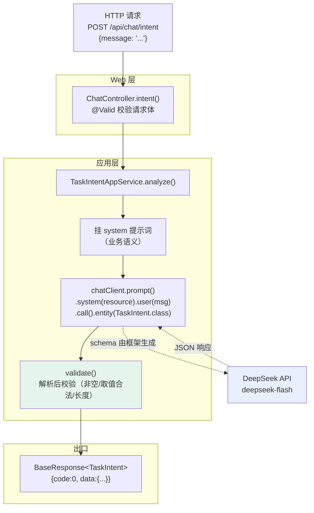

**两条并行路径（本阶段关键）**：

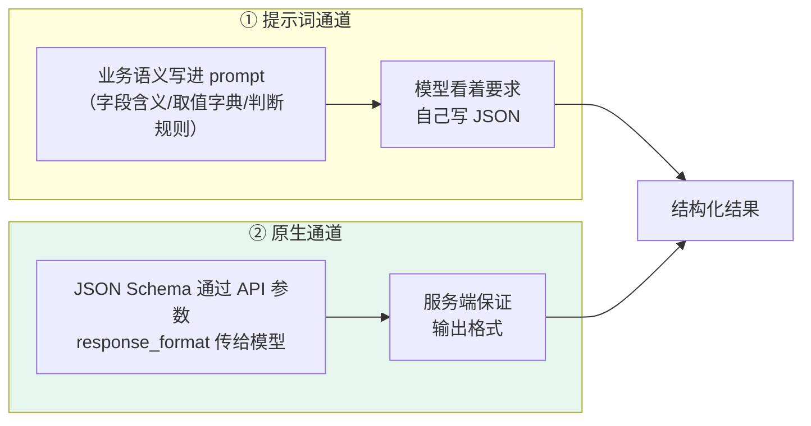

**实测结论：本项目走的是通道 ②（原生）** —— 日志里模型收到的 prompt 中
**只有业务语义，没有任何 schema 描述**（完整 1013 字符，已逐段确认）。

### 本阶段核心对象结构

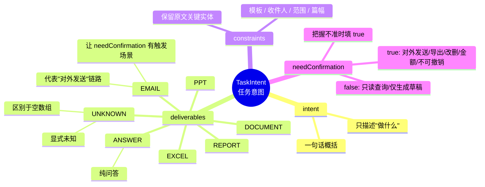

### 本阶段目标

- 让模型输出**强类型对象**而不是一段文本
- 搞清结构化输出的**两条通道**，并实测本项目走哪条
- 区分"**schema 管格式**"与"**提示词管语义**"两件事

### 本阶段价值（为什么做）

- 办公 Agent 的第一步是"**结构化地理解用户要做什么**"。拿到结构化结果，下游才能做
  确定性判断（该调什么工具、要不要先问用户、要产出什么文件），而不必解析自然语言。
- 阶段 9 的多步 Agent 直接把 `TaskIntent` 当作规划输入；
  `needConfirmation` 是阶段 10 中断确认的触发条件。
- 提示词外置成资源文件的模式，会被阶段 7（RAG 注入）、阶段 12（记忆注入）复用。

### 主要新增/涉及文件

- `src/main/java/com/hagent/dto/TaskIntent.java`
  - 类：`TaskIntent`（record）+ 内部枚举 `Deliverable`
  - 字段：`intent` / `deliverables` / `constraints` / `needConfirmation`
  - 作用：定义"任务理解"的契约；record 的字段结构会被框架生成为 JSON Schema
  - ★ 枚举 `Deliverable` 与提示词里的字典构成"**双字典**"，两者无编译期联系，
    失步会导致静默失效或解析报错（详见踩坑记录）

- `src/main/resources/prompts/task-intent-prompt.md`
  - 本阶段新增（2344 字节）
  - 内容：四个字段的**业务语义** —— 含义、合法取值、判断规则、边界与兜底
  - 作用：schema 管格式，**这份文件管语义**
  - 为什么放资源文件：提示词调整频繁，**不该需要改 Java 代码、重新编译**；
    且 Markdown 有结构、git 能 diff 出"改了什么"

- `src/main/java/com/hagent/app/TaskIntentAppService.java`
  - 类：`TaskIntentAppService`
  - 方法：
    - `analyze(String)`：`.system(resource).user(msg).call().entity(TaskIntent.class)`
    - `validate(String, TaskIntent)`：**解析后校验** —— 结构非空、交付物列表非空、
      `UNKNOWN` 不与具体值混用、约束条目长度符合约定
  - 构造器：手写（而非 `@RequiredArgsConstructor`），因为 `Resource` 参数需要
    `@Qualifier("taskIntentPrompt")` 按名限定
    - 理由：容器里可能存在多个 `Resource` 类型 Bean（Spring Boot 自身也会注册），
      不加限定有"注入到意料之外的资源"的风险，且**这类错误只在运行时暴露**

- `src/main/java/com/hagent/config/AiConfig.java`
  - 本阶段修改
  - 方法：`taskIntentPrompt()` 返回 `ClassPathResource("prompts/task-intent-prompt.md")`
  - 作用：把提示词做成 Bean，将来"不同场景用不同提示词"时加 Bean 即可，不改调用方

- `src/main/java/com/hagent/controller/ChatController.java`
  - 本阶段修改
  - 方法：`intent(ChatRequest)` → `POST /api/chat/intent`
  - 返回 `BaseResponse<TaskIntent>`，被统一响应包装

### 踩坑记录

- 问题 1：字段选型跑偏 —— 一开始选了"用户情绪倾向"
  - 现象：教练提议 `ChatReport(topic, keyPoints, sentiment)`，本人追问
    "我们的 agent 和用户情绪有什么关系"
  - 原因：**按"哪个字段好演示技术"选字段，而不是按"这个项目真的要用什么"选**
  - 处理方式：换成办公场景真正会被消费的"需求提取"结构
  - 收获：**字段的业务含义决定了这个功能有没有价值**。
    "能演示"和"会被消费"是两回事——后者才是不被清理掉的理由
    （本项目已清理过多次"备而不用"：JPA 死配置、jsoup 依赖、未使用的事件常量）

- 问题 2：`SseEmitter` 不认识 `ServerSentEvent`（阶段 3 遗留记录）
  - 现象：用 `emitter.send(ServerSentEvent)` 推送时，**一个事件都发不出去**，
    客户端只看到"连上就断"，而服务端日志干干净净
  - 原因：`ServerSentEvent` 是给 **WebFlux / 返回 Publisher** 那条路用的
    （由 `ServerSentEventHttpMessageWriter` 写帧）；
    而 `SseEmitter.send(Object)` 走 `ResponseBodyEmitter` 的普通序列化路径，
    把它当成"要转成 JSON 的普通对象"，于是构造失败。
    用 `javap` 读 `SseEmitter` 的字节码常量池可证实：**其中完全没有 `ServerSentEvent` 的引用**
  - 处理方式：改用 `SseEmitter.event()` 构建器（`name()` / `id()` / `reconnectTime()`）
  - 加固：`sendEvent` 区分"客户端断开（`IOException` → debug）"与
    "其它异常（→ warn）"——**之前的静默吞异常让这个 bug 完全没有痕迹**
  - 收获：**同一个框架里"流式"可能有两条路径，各自认不同的事件表达，不能混用**

- 问题 3：验证方法不完整（方法论层面的坑）
  - 现象：教练说"你应该能看到 `retry` 字段"，但浏览器 `EventStream` 面板不展示帧级字段，
    导致误判为功能没生效
  - 原因：把"**数据发出去了**"当成"**观察者能看到它**"
  - 处理方式：用原始 TCP 抓字节，证明 `retry:5000` 确实在帧里（首个事件带、后续不带）
  - 收获：加验证项时必须**分别确认**这两件事：
    ① 数据确实发出来了；② 观察者能看到它。二者缺一，验证就是无效的

### 阶段结果

- 接口跑通，实测返回结构化的任务意图：

```text
[任务意图] 输入=帮我把上季度华东区的费用数据整理成三页PPT发给张总
  → intent=整理华东区上季度费用数据做成PPT
    deliverables=[PPT, EMAIL]
    needConfirmation=true
    constraints=[上季度, 华东区, 三页, 发给张总]
```

- **验证了结构化输出的通道**：日志中模型收到的 prompt（完整 1013 字符）
  **只含业务语义，不含任何 schema 描述** → 本项目走**原生通道**
  （schema 由框架生成，经 API 参数传递，不拼进 prompt）
  - 这正是参考实现手册里记录过的历史教训所指向的结论；
    本阶段用自己项目的日志**独立复现**了它，而不是照抄结论
- 交付物识别正确：说了"做成 PPT + 发给张总" → `[PPT, EMAIL]`（含对外发送 → 需确认）
- 约束提取保留了原文关键实体（"张总"未被概括成"指定收件人"）

---

---

## 4. 结构化输出的通道实验（补充记录）

### 实验目的

阶段 3 里我们发现"模型收到的 prompt 中没有 schema"，据此判断走的是原生通道。
但当时**只验证了"我们这条路上没有 schema"，没验证"另一条路上有 schema"** ——
证据是单向的。本实验把两条通道**都显式跑一遍**，把差异变成可量化数据。

### 实验方式

写一个临时实验包 `com.hagent.experiment`（两个文件，验证完即删）：

- `ConverterChannelComparison`（record）：承载对比结果
- `ConverterChannelExperimentController`：两个端点
  - `GET /experiment/converter-channel/dry-run` —— **不调模型**，只打印两条通道的产物（零 token）
  - `GET /experiment/converter-channel` —— 真实调用模型两次，两条通道各一次

关键 API（用 `javap` 读字节码确认，非猜测）：

```java
StructuredOutputConverter<T> extends Converter<String,T>, FormatProvider
  String getFormat()               // 提示词通道：这段文本会被拼进 prompt
  String getJsonSchema()           // 原生通道：这段经 API 参数传递
  String NO_JSON_SCHEMA            // 缺省值：表示"没有 schema 可用"

BeanOutputConverter<T> implements StructuredOutputConverter<T>
  // 同时提供 getFormat() 与 getJsonSchema()
  // -> 一个转换器对象同时具备两条通道的表达能力，框架据内部实现选择走哪条
```

### 实验结果

| 对比项 | ① 提示词通道（`.entity(converter)`） | ② 原生通道（`.entity(Class)`，当前用法） |
|---|---|---|
| prompt 里有无 schema | 有（983 字符全进 prompt） | 无 |
| 通道产物长度 | `getFormat()` = 983 字符 | `getJsonSchema()` = 655 字符 |
| 耗时 | 2177 ms | **1572 ms（快约 28%）** |
| `intent` | 整理华东区上季度费用做成PPT | 整理上季度华东区费用数据并做PPT |
| `deliverables` | [PPT, EMAIL] | [PPT, EMAIL] |
| `constraints` | [上季度, 华东区, 三页, 发给张总] | 同左 |
| `needConfirmation` | true | true |

`getFormat()` 的组成（实测原文）：

```text
Your response should be in JSON format.
Do not include any explanations, only provide a RFC8259 compliant JSON response...
Do not include markdown code blocks in your response.
Remove the json markdown fence from the output.
Here is the JSON Schema instance your output must adhere to:
{{SCHEMA}}   ← 占位符，实际会替换为 655 字符的完整 JSON Schema
```

即：`getFormat()` = **一段英文指令（328 字符）+ 完整 schema（655 字符）**。

### 实验结论

1. **两条通道功能等价** —— 四个字段结果一致（措辞微差），说明走哪条不影响业务正确性。
2. **原生通道更快、更省 token** —— 提示词通道把 983 字符全部塞进 prompt，
   而原生通道的 schema 走 API 参数，**不占 prompt token**。
3. **★ 通道不是我们选的** —— 我们只写了 `.entity(TaskIntent.class)`，
   框架据内部实现决定走哪条。**这是观察到的行为，不是我们的决策。**
   风险：升级框架或更换模型时通道可能变化，而业务代码毫无感知 ——
   **因此必须保留验证手段**（本次实验的代码思路应留档，将来换模型时复测）。
4. **schema 从 Java 类型自动生成**（意外发现）：`Deliverable` 枚举自动变成了
   `"enum" : [ "PPT", ..., "UNKNOWN" ]`，我们没写一行 schema 定义。

### ★ 由此修正的一个认知："双字典"其实只有两处

根据实验 4 的发现，需要同步的地方不是三处而是两处：

| 字典 | 出处 | 是否自动同步 |
|---|---|---|
| 代码侧（Jackson 反序列化） | `Deliverable` 枚举 | —— |
| **schema 侧（模型输出约束）** | **框架从枚举自动生成** | ✅ **自动** |
| **提示词侧（模型看到的取值范围）** | `task-intent-prompt.md` 手写 | ❌ **需手工对齐** |

所以 `TaskIntentAppService.validate()` 里的校验，防的是"**枚举与提示词失步**"这一处，
而不是"三处失步"。负担比原先估计的小，但**这一处仍然必须防**。

> **⚠️ 前瞻声明（阶段 5 补记）**：上表提到的 `Deliverable` 枚举、`task-intent-prompt.md`、
> `TaskIntentAppService.validate()` **都已被删除**（连同整个意图理解层，见 [5.3](#53-一个被撤回的坑前置意图提取层)）。
>
> **但"双字典只有两处需要手工同步"这条认知依然有效**，它是关于**框架行为**的事实：
> schema 由枚举自动生成、提示词侧必须手工对齐。
> 阶段 7（RAG 相关性评判）与阶段 9（任务状态）若再让模型返回结构化对象，
> **这条纪律直接复用**：建新枚举时，同时确认自动生成的 schema 与手写提示词两处对齐。
>
> **而且这次撤回暴露了它的另一面**：双字典的真正危险不只是"失步"，
> 更是"**你为什么要建这本字典**"。当一本字典的存在理由本身站不住时，
> 把它维护得再同步也没有价值 —— 同步是手段，不是目的。

### 坑：把"我描述了它"当成"我做了它"

- 现象：教练在对话里贴出了实验代码，之后断言"编译通过"，但实际用工具检查发现
  **源码目录与编译产物里都没有这两个文件**，因此端点未注册，
  请求落到静态资源处理器，返回 `No static resource experiment/...`。
- 原因：**把"写进对话"当成"写进文件"**；而编译输出恰好显示 `BUILD SUCCESS`（因为真的没有源文件要编），
  造成"编译过了"的错觉。
- 修正：涉及"文件是否存在、代码是否生效"时，**必须用工具确认**（列出目录 / 检查 class 文件 /
  真实请求端点），不能凭印象断言。
- 这与之前"数据发出去了 ≠ 观察者能看到"是**同一类错误**：
  把一件事和它的表征当成同一件事。

### 坑：同一错误重复 5 次 —— API Key 未生效

- 现象：`DeepSeek API key must be set` 在协作过程中重复出现 **5 次**
- 根因：**配置来源不唯一**
  - `application-local.yml` 里是空占位符 `${DEEPSEEK_API_KEY:}`（读环境变量，没有则为空）
  - IDEA 有**两种运行方式**，环境变量来源不同：
    | 运行方式 | 环境变量 |
    |---|---|
    | 运行"当前文件"（编辑器绿色箭头） | ❌ 不带 |
    | 运行指定配置（右上角下拉框选 `HagentApplication`） | ✅ 带（已配） |
  - 命令行启动则要手动 `$env:DEEPSEEK_API_KEY=...`
- 修正方向：把 key 落进 `application-local.yml`（该文件已 gitignore、不进仓库），
  使三种启动方式都能工作；或把启动命令固化成脚本。
- 收获：**当一个操作性错误重复出现 ≥2 次时，必须机制化解决，而不是继续提醒**
  （已写入 `WORKING-AGREEMENT.md` 第 6 条）。
  重复提醒等于把"人会忘"这个事实当不存在。

---

## 5. 会话记忆的挂载（memory 抽象 + 切面）

### 本阶段数据流向

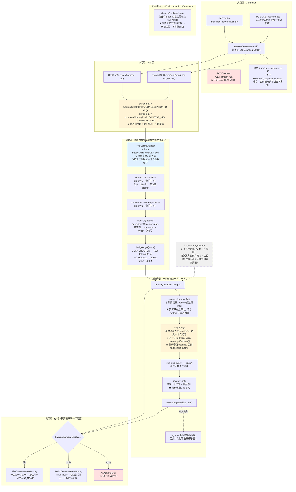

**三个必须看清的边界（这是本阶段设计的核心）**：

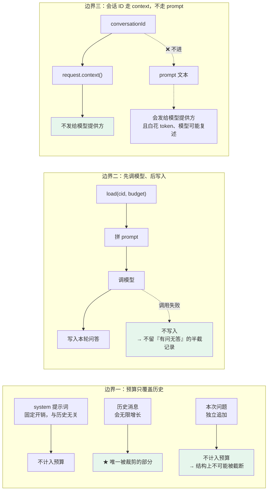

### 本阶段核心对象结构

```mermaid
mindmap
  root(("阶段5<br/>会话记忆"))
    抽象层
      ConversationMemory 接口
        append / load(id, budget) / clear / delete
        ★ 换实现只改配置的落点
        ★ 边界声明：不是长期记忆、不做摘要
      TokenBudget record
        maxTokens + maxMessages，构造校验 > 0
        ★ 预算口径：只管历史
      MemoryMode 枚举
        CONVERSATION / WORKFLOW
        CONTEXT_KEY = hagent_memory_mode
        ★ 模式由调用方显式声明，切面不猜
    实现层 三个
      InMemoryConversationMemory
        兜底 + 测试用，重启即丢
      file/FileConversationMemory
        一会话一 JSON，原子写
        零基础设施、人可读、可审计
      redis/RedisConversationMemory
        ★ 定位是缓存，带 TTL
        不是权威存储（权威是阶段7的 MySQL）
    装配层
      MemoryConfig @ConditionalOnProperty
        刻意不用 ConditionalOnMissingBean
      MemoryConfigValidator EnvironmentPostProcessor
        LOWEST_PRECEDENCE（必须在配置加载之后）
        mysql 未实现 → 启动失败，不静默降级
      MemoryProperties InitializingBean
        参数全部外置，含 mysqlTableName 预留
    切面层
      ConversationMemoryAdvisor order=1
        augment 读一次 / recordTurn 写一次
      共用工具
        MemoryTrimmer 裁剪规则唯一出处
        MessageCodec 序列化唯一出处
    两个必须避开的坑
      EnvironmentPostProcessor 顺序
        HIGHEST 读不到配置
      Bean 自检不可行
        缺依赖时 Spring 先失败
```

### 本阶段目标

- 把"多轮对话能记住前文"变成链路上的一个**可替换组件**，而不是写死在业务代码里
- 建立会话记忆的**抽象与实现分离**：接口在本项目手里，实现由配置切换（file / redis / 阶段 7 的 mysql）
- 让"预算"成为**调用方显式声明**的参数，而不是藏在实现内部的魔数
- 让"配置了不存在的实现"变成**启动期明确失败**，而不是运行期静默降级

### 本阶段价值（为什么做）

- **会话记忆是 Agent 的地基之一**：没有它，多轮对话里"改成10页"这种追问无法解析（"它"指什么）
- **抽象与实现分离是本项目"高扩展性"主张的第一个真实落点**：阶段 7 加 MySQL 实现时，
  `ChatAppService` / 切面 / 三个已有实现**一行都不用改** —— 这是可验证的，不是口号
- **预算显式化直接对应成本控制**：会话模式 5000 token 与工作流模式 50000 token 差 10 倍，
  这个差异必须在调用点可见，否则"这次带了多少历史"无从得知
- **启动期守卫防的是本项目全篇在防的那类问题**：配置没生效却看起来正常

### 主要新增/涉及文件

**新增（15 个）**

| 分类 | 文件 | 作用 |
|---|---|---|
| 抽象 | `memory/ConversationMemory.java` | 核心接口；类注释里写明"不是长期记忆、不做摘要"的边界 |
| 抽象 | `memory/TokenBudget.java` | record；表达"预算只管历史"这条口径 |
| 抽象 | `memory/MemoryMode.java` | 模式枚举 + context key；**模式由调用方声明，切面不猜** |
| 抽象 | `memory/MessageCodec.java` | `Message ↔ StoredMessage` 转换的唯一出处（三实现共用） |
| 实现 | `memory/InMemoryConversationMemory.java` | 兜底 + 单测用 |
| 实现 | `memory/file/FileConversationMemory.java` | 默认实现；原子写（临时文件 + `ATOMIC_MOVE`） |
| 实现 | `memory/redis/RedisConversationMemory.java` | 缓存定位；TTL 86400s |
| 裁剪 | `memory/MemoryTrimmer.java` | 裁剪规则唯一出处；token + 条数双限制 |
| 配置 | `memory/MemoryProperties.java` | 绑定 `hagent.memory.chat.*` |
| 装配 | `memory/MemoryConfig.java` | 两个 `@ConditionalOnProperty` Bean |
| 守卫 | `memory/MemoryConfigValidator.java` | `EnvironmentPostProcessor`，启动期校验 `type` |
| 桥接 | `memory/ChatMemoryAdapter.java` | 适配成框架 `ChatMemory`。**不在主链路，但不可删** —— 它是框架边界的预算闸门 + 占位（见下方"坑 4 的复核补充"） |
| 切面 | `advisor/MemoryReadAdvisor.java` + `advisor/MemoryWritebackAdvisor.java` | 读历史写 context / 调完写回一次。★ 原为一个 `ConversationMemoryAdvisor`，阶段 6 后半按"位置要求相反"拆成两个 |
| 注册 | `META-INF/spring.factories` | 注册 `MemoryConfigValidator` |
| 测试 | `memory/MemoryTrimmerTest.java`、`memory/file/FileConversationMemoryTest.java` | 17 个用例 |

**修改**

| 文件 | 改动 |
|---|---|
| `dto/ChatRequest.java` | 加可选 `conversationId`；服务端生成随机 UUID（防 IDOR 越权） |
| `controller/ChatController.java` | 加常量 `CONVERSATION_ID_HEADER`、`resolveConversationId()`；`/chat` 与 `/stream-sse` 回写响应头 |
| `app/ChatAppService.java` | `chat(msg)` → `chat(msg, cid)`；加两行 `.advisors(...)`；`streamWithServerSentEvent` 同步接入 |
| `config/AiConfig.java` | `chatClient` 加两个默认切面（顺序由数据依赖决定）；新增 `conversationMemoryAdvisor`、`chatMemory` Bean |
| `config/WebConfig.java` | `exposedHeaders` 加入会话 ID 头（不暴露则前端读到 null 且不报错） |
| `resources/application.yml` | `hagent.memory.chat.*` 从 2 行扩为 13 行有效配置，每项写明取值依据 |

### 踩坑记录

> #### ★ 先说一个贯穿全阶段的系统性发现：协议级异常被报成了"服务内部错误"
>
> 本阶段在验证过程中**两次**撞上同一类问题，第二次才看出它不是偶然：
>
> | 触发场景 | 修正前返回 | 应该返回 | 怎么发现的 |
> |---|---|---|---|
> | 访问不存在的路径 | `500` + `50000 服务内部错误` | `404` + `40004 接口不存在` | 删掉旧端点后测"它该返回什么" |
> | **用 GET 访问 POST 接口** | `500` + `50000 服务内部错误` | `405` + `40005` + **`Allow: POST`** | 在浏览器地址栏直接访问接口 |
> | Content-Type 用错 | `500` + `50000 服务内部错误` | `415` + `40006` | 同一类，一并补上 |
>
> **共同特征**：**问题在调用方，却被报成了服务端故障。**
> 后果是排查方向完全错位 —— 看到 500 会去查日志、查数据库、查依赖，
> 而真相可能只是"URL 拼错了"或"方法用错了"。
>
> **根因**：Spring MVC 的这些**协议级异常**（`NoResourceFoundException`、
> `HttpRequestMethodNotSupportedException`、`HttpMediaTypeException`）
> 在全局异常处理器里**没有显式分支**，于是落进了 `Exception.class` 兜底。
>
> **① 这个缺口是被"兜底处理器自己"报出来的**：它每次都打印
> `[未预期异常] 类型=xxx —— 需要补一条显式异常处理分支`。
> 这正是当初把兜底写成"显式报告缺口"而不是"静默返回 500"的价值 ——
> **它把一次未知的故障，变成了一条可执行的待办**。
>
> **② 405 必须回 `Allow` 头**：这是 HTTP 规范要求，也是 405 相对 500 的**核心价值** ——
> 它不只说"你错了"，还说"该用什么方法"。没有它，调用方只能去翻文档或源码。
> 同理 415 要回 `Accept` 头。
>
> **收获（可迁移）**：
> - **补异常分支时，要按"一类"补，而不是按"一个"补。** 第二次撞上同类问题时，
>   正确反应不是再补一条，而是问"这一类还有哪些"。
> - **区分"调用方错误"与"服务端故障"是异常策略的第一性问题。** 前者记 WARN 且不回 5xx，
>   后者记 ERROR 且必须查日志 —— 混在一起会让两边都失效。
> - **兜底处理器的正确写法是"报出缺口"，不是"体面地兜住"。**
>   静默兜住会让缺口永远不被发现，而本项目全篇在防的正是这个。
>

#### 坑 1：`EnvironmentPostProcessor` 用 `HIGHEST_PRECEDENCE` 读不到配置

- **现象**：校验器误报"`hagent.memory.chat.type` 不能为空"，而 `application.yml` 里明明写了。
- **原因**：**加载 `application.yml` 这件事本身也是由一个 `EnvironmentPostProcessor` 完成的**
  （`ConfigDataEnvironmentPostProcessor`）。抢在它之前运行，Environment 里自然还没有 YAML 属性。
- **处理**：`getOrder()` 改为 `Ordered.LOWEST_PRECEDENCE` —— "等配置加载完、但仍在 Bean 创建之前"。
- **收获**：**扩展点的执行时机不是可以随便调的**，它由"谁先产出我依赖的数据"决定。

#### 坑 2：把校验做成 Bean，永远轮不到它执行

- **现象**：想让校验先跑，于是做成 Bean 并让 `chatClient` 依赖它 —— 结果**仍然没执行**。
- **原因**：`chatClient` 的构造器参数里**同时**需要 `ConversationMemory`。
  Spring 解析参数时第一个就发现"这个 Bean 不存在"，**直接抛错返回，不会再去创建其它参数**。
  校验器排在参数列表后面，永远轮不到。
- **处理**：改用 `EnvironmentPostProcessor`（在任何 Bean 创建之前运行）。
- **收获**：**用"依赖关系"来保证执行顺序，前提是那个依赖真的能被解析到** ——
  否则报错发生得更早，你想保的那步根本没机会跑。

#### 坑 3：`SseEmitter` 不认识 `ServerSentEvent`（阶段 2 遗留，此处被流式记忆再次触发）

- **现象**：把 `ServerSentEvent` 对象交给 `SseEmitter.send(...)`，**一个事件都发不出去**，
  客户端只看到"连上就断"，而服务端日志干干净净。
- **原因**：`SseEmitter.send(Object)` 走的是 `ResponseBodyEmitter` 的普通序列化路径，
  会把对象当"要转 JSON 的普通数据"。`ServerSentEvent` 是给 **WebFlux / 返回 Publisher** 那条路用的。
  用 `javap` 读 `SseEmitter` 的字节码常量池可以证实：里面根本没有 `ServerSentEvent` 的引用。
- **处理**：手动推送改用 `SseEmitter.event()` 构建器。
- **收获**：**同一个类型名，在不同的执行路径上含义不同。** 判断"能不能这样用"要看真实签名，
  不能靠名字相似。

#### 坑 4：`ChatMemoryAdapter` 的模式用"取最大预算"来回避歧义

- **现象**：适配器只持有一个预算，取的是 `workflowMaxTokens`，注释写着"用工作流预算作为适配器层的上限"。
- **原因**：那是**用数量级掩盖歧义** —— "反正它是最大的，读不丢"。
  但它没有回答"这次调用属于哪种模式"，只是让后果看起来不明显。
- **处理**：改成 `Map<MemoryMode, TokenBudget>`，每个模式各绑它自己的两项配置；
  新增显式带模式的 API（`loadFor` / `appendFor` / `remember`）。
  框架接口 `get(id)` 无处传模式，只能用旁路表补，且**查不到时 WARN 而不是猜**。
- **收获**：**"取一个足够大的值"不是消除歧义，是隐藏歧义。**
  真正的解法是让调用方把缺失的信息显式传进来。

#### 坑 4 的复核补充（阶段 6 后半）：★ 它是"闸门 + 占位"，**不能删**

阶段 6 后半有人（正确地）注意到 `ChatMemoryAdapter` **零调用方**、而且
"模式 → 预算"这张表在它和 `MemoryReadAdvisor` 里**各抄了一份**，于是提出删掉它。

**这个建议是错的**，而且错得很有价值 —— 因为当时的文档就是这么写的：

```text
ChatMemoryAdapter  ★ 不在主链路上！仅作为 Bean 预留（将来挂框架自带切面时才用）
```

"仅作为 Bean 预留" 读起来就是"备而不用"，于是"零调用方"被当成了"可以删"。
**但它是零调用方，不等于它没作用。** `javap -v` 实测框架的自动配置：

```java
@AutoConfiguration
@ConditionalOnClass({ChatMemory.class, ChatMemoryRepository.class})
class ChatMemoryAutoConfiguration {
    @Bean @ConditionalOnMissingBean                       // ★
    ChatMemoryRepository chatMemoryRepository() {
        return new InMemoryChatMemoryRepository();        // 堆内存
    }
    @Bean @ConditionalOnMissingBean                       // ★
    ChatMemory chatMemory(ChatMemoryRepository repo) {
        return MessageWindowChatMemory.builder()
                .chatMemoryRepository(repo).build();      // 只有条数窗口，无 token 预算
    }
}
```

两个 `@ConditionalOnMissingBean` 的含义是：**我们的 Bean 在，框架的不建；
我们的 Bean 一删，框架立刻装一个自己的** —— 而那个是
**纯内存（重启即丢）+ 无 token 预算 + 无模式概念**。

★ 这正好命中 `MemoryProperties.afterPropertiesSet()` 自己警告过的失败模式：
"你以为在用 MySQL 存，实际历史在堆里、重启就丢，且不报错"。

**所以它的作用有两半，缺一不可**：

| 作用 | 说明 |
|---|---|
| **闸门** | 把预算绑在框架边界上。框架的 `ChatMemory.get(String)` **没有预算参数**，不在这里绑一个已配置的预算，接框架组件时就是**无界读取历史** |
| **占位** | 只要它在容器里，框架那个"无预算 + 纯内存"的实现就进不来 |

**可迁移的判据（本轮最值钱的一条）**：

> **判断一个零调用方的类能不能删，不能只看"谁调它"，还要看"没有它会发生什么"。**
> 有些零调用方的 Bean 是在**占位** —— 挡住的是框架的默认实现。
> 而"预留"这个词会掩盖这一点：**预留听起来是"将来才有用"，占位是"现在就在起作用"。**

**同时修掉的两件事**：

1. **重复是真的**（"模式 → 预算"写了两遍），但修法是**共用**而不是删除 ——
   抽出 `MemoryBudgets` 值对象，两个调用点共用同一份；
   并且内部用**穷尽的 `switch` 表达式 + 遍历 `MemoryMode.values()` 建表**，
   把"新增模式漏配"从**运行期 NPE** 变成**编译期错误**（`Map.of` 手写列举没有任何机制保证覆盖）。
   → 回归防线：`MemoryBudgetsTest#advisorAndAdapterAgreeOnTheSameBudget`
   断言两条路径对同一模式拿到**同一个**预算。**该测试已用"植入缺陷"验证过确实会失败**。
2. **陈旧注释**：删掉 `ConversationMemoryAdvisor` 时留下了 3 处在用**已删除的类名**
   描述**当前行为**（其中 `ChatMemoryAdapter` 原注释还声称主链路用 `loadFor`，
   与事实相反、且与同段另一句自相矛盾），已一并修正。

#### 坑 5（跨阶段的模式）：配了却没人读 —— 一个"死字段"

- **现象**：`ConversationMemoryAdvisor` 里同时存在 `conversationBudget` 与 `workflowBudget` 两个字段，
  但预算选择方法 `budgetFor(Prompt)` **永远返回会话预算**。`workflow-max-tokens: 50000` 配了等于没配。
- **更糟的是它的注释**：写着"阶段 9 会在 context 里放 MODE 标记，届时把判断改为读 context"——
  而那个方法**签名里是 `Prompt`，根本拿不到 context**；那个机制**当时也不存在**。
  注释在为一个不存在的实现作保。
- **处理**：引入 `MemoryMode` 枚举，模式经 context 显式传递，预算表按模式索引。
- **收获**：**"写了"不等于"生效"。** 一个字段被赋值但无人读取，编译、测试、运行全都正常 ——
  这类问题的唯一发现方式，是**逐个字段去问"谁读它"**。

### 阶段结果

- **测试**：53 个用例全绿（`FailureMapper` 26 + `FileConversationMemory` 9 + `MemoryTrimmer` 8 + `SseSupport` 5 + `GlobalExceptionHandler` 5）
- **换实现只改配置**：实测 `type: file` ↔ `type: redis` 一行配置切换，**零 Java 改动**，
  日志分别为 `[记忆] 使用文件实现` / `[记忆] 使用 Redis 实现`
- **fail-fast 生效**：配 `type: mysql` 时启动即失败，报错写明"已实现 [redis, file]、
  阶段 7 提供 MySQL、为什么直接失败而不降级"。堆栈落在
  `SpringApplication.prepareEnvironment(...)` —— 证明校验确实在任何 Bean 创建之前执行
- **未完成的验证（诚实记录）**：`tmp/chat-memory` 目录至今为空，因为所有验证请求都用了无效
  API Key（模型调用失败 → 按"先调模型后写入"的设计不落盘）。
  也就是说**"记忆真的被注入、模型真的用上了"尚未被实测证明** ——
  验证清单见 `docs/STAGE5-VERIFICATION.md`，需用真实 Key 执行

### 5.3 一个被撤回的坑：前置意图提取层

> 这一节是本项目的**最大一次设计返工**，记录在此是因为它的教训可以迁移到任何项目。

#### 当初怎么想的

在模型调用**之前**，先让模型解析出结构化的"任务意图"（该产出什么文件、有什么硬性要求、
要不要先问用户确认），然后由**代码**依据这份 intent 决定挂载哪些工具。
听起来是"用确定性换可靠性"：不让模型自由发挥，而是先拿到结构化结果再做判断。

#### 做到哪一步才发现不对

这一层**代码写完了**：DTO（含交付物枚举）、Service（含解析后校验）、提示词文件、独立端点
`POST /api/chat/intent`，还有配套的"双字典同步"纪律（枚举与提示词里的取值必须手工保持一致）。

**转折点是追问一句："intent 的结果落到哪里、谁读它？"** —— 这个问题**答不出来**：

- 全项目搜索，`intent` 的消费者**只有它自己的端点**；`ChatAppService` **完全不读它**
- 也就是说，它算出来的东西**存在那儿，等人用**。而"等人用"的产出，就是死代码

#### 三个致命问题（逐个都是独立的否决理由）

**① 它和模型自己的工具调用在重复同一个判断**

```
intent 层：  给模型看【用户的话 + 交付物枚举字典】→ 问它"该产什么"
工具调用：   给模型看【用户的话 + 工具 JSON Schema】→ 问它"该调哪个工具"
                    ↑ 同一个判断、同一份信息源、同一个模型
```

多出来的这一层**不提供任何模型不知道的信息**，只是把同一个决策提前做了一遍，
再用另一种格式喂回去。而且 DeepSeek **原生支持结构化输出**（阶段 3 已实测：
JSON Schema 通过 API 参数下发，prompt 里没有 schema 文本）——
也就是说"按 schema 输出该调哪个工具"这个能力**框架本来就有**。

**② 两遍判断会产生两个答案，而它们可能不一致**

```
intent 分析说："交付物 = PPT"
模型挂工具时说："我调 Excel 工具"    ← 谁说了算？
```

更糟的是，如果让 intent 去**约束**工具选择，就是在用一次"信息更少的判断"
去限制"信息更多的判断"—— 模型看到的上下文比你多（完整 prompt、工具返回结果、多步中间状态）。

**③ 它引入了第二对必须手工同步的字典**

阶段 3 已经确认过一条纪律：**"双字典"是本项目的一个真实陷阱**（枚举与提示词里的取值列表
没有任何编译期联系，失步时会静默失效）。intent 层等于**又加了一对**：
工具改名、加工具时，意图里的枚举不会自动跟着变。

#### 连带发现的第四个问题：它连"挂在哪"都是错的

在论证过程中还发现，即使保留 intent 层，**它作为切面挂进切面链也是错的**：

- 框架的 `ToolCallingAdvisor` order = `Integer.MIN_VALUE + 300`（★ 曾误写为 `+200`，阶段 6 后半用
  `javap -constants` 实测更正），在**最外层**，负责工具调用循环
- 所以任何挂在链上的切面，**在逻辑上都处于工具循环内部**，会被**重复执行 N 次**
- 每次重复都白烧一次模型调用，且它看到的每次都是"带工具结果的消息"

正确做法是**独立执行单元**（app 层编排，不进切面链）—— 但那时已经确定这一层根本不需要，
所以没有走到那一步。

#### 处理

**整体删除**：DTO、Service、提示词文件、端点、Bean，以及所有引用。
删除后用 `clean test` + 真实启动 + HTTP 实测三重确认无残留
（`target/` 下无 class、`prompts/` 目录消失、`/api/chat/intent` 返回 404）。

#### 收获（已写入 `WORKING-AGREEMENT.md` 第 7 条）

**① 动手前必须能回答三个问题，答不出来就不做：**

| 问题 | 当初的答案 |
|---|---|
| 它解决什么具体问题？ | ~~"用确定性换可靠性"~~（模糊，说不出具体问题） |
| **它的产出谁消费？** | ❌ **答不出来** —— 这正是致命的那一问 |
| 不做它会怎样？ | ~~"不够工程化"~~（说不出具体功能缺失） |

**② 更贵的错误不是"写错代码"，而是"写了一层根本不该存在的代码"。**
后者能编译、测试能过、架构图很好看，但它是**纯粹的复杂度**。

**③ 警戒信号**（出现即停下来重新论证）：产出的东西"以后会被用到"；
让模型做两遍同一个判断；靠"两个组件约定不互相干涉"来维持隔离；
需要在注释里反复解释"它其实不参与主流程"。

**④ 一个反直觉的发现**：这一层的**技术实现全都正确** ——
结构化输出跑通了、双字典同步做了、解析后校验写了。
**没有一处代码是错的，错的是"要不要做它"这个判断。**
这类错误靠 code review 抓不到，只能靠**动手前的那三问**。

---

## 6. RAG 知识库 · 入库链路（加载 → 切分 → 打标签 → 向量化）

> **本阶段范围声明**：本节只覆盖**入库链路**。检索链路（向量检索、权限过滤、
> prompt 拼装聚合器、RAG 切面）**尚未实现**，它属于阶段 6 的后半部分。

### 本阶段数据流向

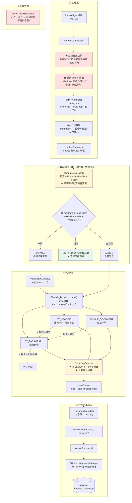

**三条降级路径（切分策略的完整决策树）**：

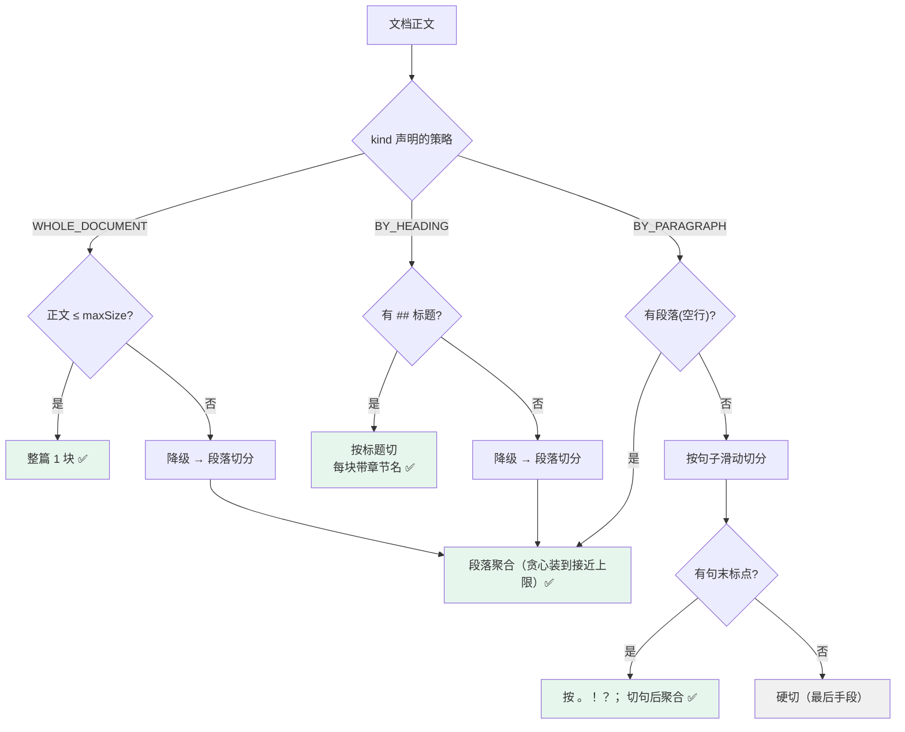

### 本阶段核心对象结构

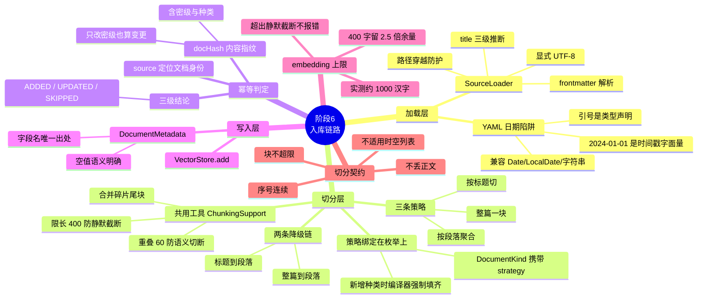

### 本阶段目标

- 把"企业自有文档"变成**可被检索的知识**：加载 → 切分 → 打标签 → 向量化 → 落 pgvector
- **幂等**：同一份文档重复入库不产生重复数据、不重复付 embedding 成本
- **策略与文档种类绑定**：不同种类的文档走不同的切分策略，而策略声明只有一处
- 让 `embedding 静默截断` 这类"不报错的错误"在结构上不可能发生

### 本阶段价值（为什么做）

- **这是 RAG 的地基**：检索质量的上限由入库质量决定。切分错了，再好的检索算法也救不回来
- **幂等直接对应成本与正确性**：知识库需要"每天同步一次"，无变化时应当零 embedding 成本；
  而"更新文档"若不删旧块，旧版本内容会继续被检索命中 —— **用户拿到已废止的规定，而系统毫无异常**
- **`DocumentKind` 承载策略**是本项目"防双字典陷阱"的又一次落地：
  新增文档种类时，编译器强制你在枚举常量里填齐"切分策略"与"默认密级"
- **元数据字段名只有一处**（`DocumentMetadata.FIELD_*`）：元数据是"入库写、检索读"的领域，
  字段名写错不会有编译错误，只会让过滤条件永远不命中

### 主要新增/涉及文件

**新增（21 个主代码 + 5 个测试 + 4 份示例数据）**

| 分类 | 文件 | 作用 |
|---|---|---|
| 领域模型 | `document/AccessLevel.java` | 密级枚举（`PUBLIC`/`INTERNAL`/`CONFIDENTIAL`）+ `rank` 比较 + 默认偏保守 |
| | `document/DocumentKind.java` | **文档种类枚举，策略跟着枚举走**（切分策略 + 默认密级） |
| | `document/ChunkingStrategy.java` | 三种切分策略的声明 |
| | `document/DocumentMetadata.java` | **元数据 schema，字段名唯一出处**（12 字段 + `FIELD_*` 常量 + 空值语义） |
| | `document/Chunk.java` | 块的载体（index/total/section/text） |
| | `document/LoadedDocument.java` | 已加载文档（含 frontmatter 结果） |
| | `document/IngestOutcome.java` | 处理结论枚举（`ADDED`/`UPDATED`/`SKIPPED_UNCHANGED`） |
| | `document/IngestResult.java` | 单文档入库结果 |
| 工具 | `document/HashingSupport.java` | SHA-256 内容指纹（归一化换行符，跨平台一致） |
| 加载 | `document/SourceLoader.java` | 读 `.md`/`.txt` + frontmatter 解析 + **路径穿越防护** |
| 切分 | `document/chunking/TextChunker.java` | 切分接口（四条契约） |
| | `document/chunking/ChunkingSupport.java` | 限长/重叠/碎片合并的**唯一出处** |
| | `document/chunking/WholeDocumentChunker.java` | 整篇一块（超长返回空列表 → 降级） |
| | `document/chunking/HeadingChunker.java` | 按 Markdown 标题切（带章节名） |
| | `document/chunking/ParagraphChunker.java` | 按段落聚合切（内部可降到句子） |
| | `document/chunking/ChunkingDispatch.java` | **降级链的唯一持有者** |
| 配置 | `config/ChunkingProperties.java` | 切分参数（含取值依据与 embedding 上限说明） |
| | `config/IngestProperties.java` | 入库参数（`default-kind` 刻意无默认值） |
| | `config/RagConfig.java` | RAG 配置类注册 |
| 编排 | `app/DocumentIngestService.java` | **入库编排**（幂等判定 + 删旧写新 + 批量扫描） |
| | `app/BatchIngestReport.java` | 批量报告（**含结构化失败清单**，不只是计数） |
| 测试 | `document/chunking/TextChunkerTest.java` | 17 个用例：契约、边界、章节名、Markdown 识别 |
| | `document/chunking/ChunkingSupportTest.java` | 7 个用例：**暴力组合扫超限**（见坑 4） |
| | `app/DocumentIngestIntegrationTest.java` | 14 个用例：真实 pgvector + 真实 embedding，每个方法自给自足 |
| | `app/DocumentIngestStableStateTest.java` | 6 个用例：需要"全库已入库"状态的断言 |
| | `app/KnowledgeCleanupListener.java` | 每个测试方法前清空向量表 |
| 数据 | `knowledge/*.md`、`knowledge/*.txt` | 4 份示例文档，**每份覆盖一条不同的代码路径** |

**修改**

| 文件 | 改动 |
|---|---|
| `pom.xml` | **显式声明 snakeyaml**（原为传递依赖；代码里直接 import 的东西应当显式声明） |
| `config/VectorStoreProperties.java` | `initializeSchema` false→**true**（见坑 1）；新增 `vectorTableValidationsEnabled` |
| `config/VectorStoreConfig.java` | 抽出 `pgVectorJdbcTemplate` Bean（与 PgVectorStore 共用）；自检从 WARN 升级为**缺失即启动失败**；新增列类型打印 |
| `resources/application.yml` | 新增 `hagent.rag.*` 配置段（39 行，每项带取值依据） |
| `docs/WORKING-AGREEMENT.md` | 新增**第 10 条**：切面必须考虑内层重复调用，可重复的用幂等 |

### 踩坑记录

#### 坑 1：向量表**从未被创建过** —— 一条"看起来配对了"的配置

- **现象**：集成测试在写入时报错，提示表不存在。而此前阶段 0 的启动自检只打印过一条
  `WARN 表 'hagent_knowledge' 尚不存在 —— 阶段 7 会用显式 DDL 创建`，没人当回事。
- **原因**：反编译 `PgVectorStore.afterPropertiesSet()` 的字节码，其逻辑是：

  ```text
    if (schemaValidation) { 校验表名合法性 }
    if (!initializeSchema) {
        只记一条 debug 日志，然后 validateTableSchemaIfEnabled();
        return;                    // ★ 直接返回，不建表
    }
    ... CREATE EXTENSION / CREATE SCHEMA / CREATE TABLE / CREATE INDEX
  ```

  本项目的配置是 `initialize-schema: false` + `schema-validation` 默认 false，
  **两个开关都是假** → 表永远不会被创建。
- **为什么此前没暴露**：阶段 0 只做了**连通性探测**（直查 `information_schema`），
  没有写入路径。**没有代码走过那条路，配置错不错就无从验证。**
- **处理**：`initialize-schema: true`（交给框架建表），并把启动自检从"仅告警"
  升级为"**表不存在即启动失败**"。
- **收获（可迁移）**：
  1. **一个配置项是否生效，不能看它写没写，要看有没有代码走那条路。**
     阶段 0 的探测是只读的，所以整条写入路径的配置从未被验证过。
  2. **告警会被忽略。** 同一条 WARN 存在很久没人处理 ——
     当"表不存在"真的会导致功能全废时，它就不该是 WARN 而该是**启动失败**。
     这与本项目"兜底处理器要报出缺口"的立场一致：**错误的严重程度要匹配后果**。

#### 坑 2：`validFrom: 2024-01-01` 被 YAML 解析成 `Date` 对象

- **现象**：入库直接失败 ——
  `frontmatter 的 validFrom 不是合法日期：Mon Jan 01 08:00:00 CST 2024`
- **原因**：**YAML 1.1 里 `2024-01-01` 是时间戳字面量**，隐式类型解析会把它转成
  `java.util.Date`，于是 `String.valueOf(...)` 得到英文长日期，再 `LocalDate.parse` 必然失败。
- **收获**：**引号不是装饰，是类型声明。**
  在 YAML 里 `2024-01-01` 与 `"2024-01-01"` 是两种不同的值。
  这类问题的排查成本很高 —— 报错信息里显示 `Mon Jan 01 ...`，
  而配置文件里明明写着 `2024-01-01`，一眼看不出因果。
- **处理**：`parseDate` 同时接受 `Date`/`LocalDate`/`LocalDateTime`/`Calendar` 与字符串
  （这样作者写不写引号都能工作），但**对无法解析的值仍然明确报错**而不是静默忽略。
  同时在示例文档与 `docs/KNOWLEDGE-SAMPLE-DATA.md` 里示范**加引号**的写法。

#### 坑 3：降级链的顺序错了 —— "结构化程度"不是降级依据

- **现象**：`公司介绍.md`（正文 717 字，超过 400 上限，且**一个标题都没有**）
  被切成 2 块，本以为会走 `BY_PARAGRAPH`，日志显示它先试了 `BY_HEADING`。
- **原因**：最初的降级链是 `WHOLE_DOCUMENT → BY_HEADING → BY_PARAGRAPH`，
  理由是"标题比段落更结构化"。但**降级的对象是切分粒度，不是文档结构类型**：

  ```text
    真正要表达的是：整篇一块（最粗） → 按段落（中等） → 按句子（最细）
    BY_HEADING 是【平行策略】，只在文档确实有标题时才有意义 ——
    而"整篇装不下"这件事本身并不提示文档有标题
  ```

- **处理**：降级链改为 `WHOLE_DOCUMENT → BY_PARAGRAPH`。
  有标题的文档一开始就声明了 `BY_HEADING`，不依赖这条链。
- **收获**：**平行的策略之间不存在"降级"关系。** 把两种独立方案硬排成一个序列，
  会产生"走了一轮无效尝试"的浪费，并让日志误导人以为某个策略生效过。

#### 坑 4 ★：`overlap` 没被计入大小检查 —— 系统性突破上限

> **这是本阶段最严重的缺陷，也是"暴力组合测试"价值最直接的体现。**

- **现象**：暴力组合测试（穷举 `maxSize` × `overlap` × 文本长度）一次性报出
  **200 多个超限组合**，且超出幅度随 `overlap` 增大而恶化：

  ```text
    maxSize=60 overlap=45 → 产出 95 字的块（超 35 字）
    maxSize=80 overlap=45 → 产出 102 字的块（超 22 字）
    maxSize=40 overlap=20 → 产出 60 字的块（超 20 字，即超出上限的 50%）
  ```

- **原因**：`enforceMaxSize` 的写法是"判断要不要开新块 → 开新块 → **追加重叠** → 追加上句子"，
  而**大小检查只发生在追加重叠之前**：

  ```java
    if (current.length() + sentence.length() > maxSize) {   // ← 检查时 current 是空的
        ...
        current.append(tailOverlap(previous, overlap));      // ★ 追加后没有再检查
    }
    current.append(sentence);                                // ★ 于是可能超限
  ```

  关键在于 `tailOverlap` 会"退到最近的句子边界"，**它的返回值可能远大于 `overlap` 参数**。
  `ParagraphChunker` 里还有同类的两处（"重叠 + 已限长的片段"必然超限、大小检查漏算换行符）。
- **为什么手写测试没发现**：手写用例很难恰好撞上"句子长度 / 重叠长度 / 上限"三者的
  特定相对关系。**这个缺陷只在参数组合的密集扫描下才暴露。**
  真实配置 `maxSize=400 / overlap=60` 恰好没触发（60 相对 400 很小），所以手写用例全绿 —— 而缺陷一直在。
- **后果的严重性**：块超过 `maxSize` → embedding **静默截断** →
  **块尾内容永远检索不到，且没有任何报错**。这正是本阶段的核心防范目标，却在实现里被自己违反了。
- **处理**：把重叠的追加纳入大小决策 —— 先算候选重叠，只有它与下一句能一起装下时才用；
  装不下就**放弃这一块的重叠**。取舍理由：重叠是"锦上添花"（提升语义连续性），
  超限是"正确性问题"（内容永久检索不到），冲突时必须保上限。
- **收获（可迁移）**：
  1. **"先追加、后检查"是危险模式** —— 检查过了不代表追加后还成立。
     凡是"拼接 + 有上限"的逻辑，都要在**每次追加之后**保证不变量仍然成立。
  2. **参数的边界组合要靠穷举，不能靠挑用例。** 本例的教训是：
     真实配置恰好避开了缺陷，于是手写测试给了一个**虚假的安全感**。
  3. **一个不变量一旦成为"核心防范目标"，就要为它写穷举测试。**
     "每块 ≤ maxSize"在本项目里等于"防 embedding 静默截断"，
     它的重要性配得上一次参数空间扫描。

#### 坑 5：集成测试依赖了"上一次运行留下的数据库状态"

- **现象**：集成测试**单独跑能过，全量跑失败 4 个**：

  ```text
    firstIngestOfMarkdownIsAdded   expected: ADDED   but was: SKIPPED_UNCHANGED
  ```

- **原因**：用例断言"首次入库应当 ADDED"，但库里残留着上一次运行写入的数据，
  于是"首次"变成了"重复"，被**正确地**判定为跳过 ——
  **被测系统的行为是对的，错的是测试对环境状态的假设。**
- **第一次修法与它的反效果**：加了"每个测试方法前清空向量表"的监听器之后，
  那些**依赖前序用例已入库**的断言（如"批量入库应当全部跳过"）又反过来失败了。
  两次失败指向**同一个根因：测试方法之间有隐式依赖。**
- **处理**：拆成两个类，按需求性质区分：
  - `DocumentIngestIntegrationTest`：每个方法**自给自足**（清库 → 自己入库 → 断言），
    可任意顺序、任意次数运行；
  - `DocumentIngestStableStateTest`：需要"全库已入库"这一稳定状态，
    在 `@BeforeAll` 里**幂等准备**（检查库里有没有数据，没有才入库）。
- **收获**：
  1. **顺序依赖的测试在"单独跑"与"全量跑"时行为不同** —— 失败时无法判断
     是代码坏了还是顺序变了，**它作为回归防线的价值大打折扣**。
  2. **"让测试能独立运行"不是洁癖，是可靠性的前提。**
  3. 判断一个测试该怎么写，先问：**它需要的前置状态，能不能由它自己建立？**
     能 → 自给自足；不能（需要大规模状态）→ 放到专门的类里做一次幂等准备。

#### 坑 6：测试的"自动清理"必须自动，不能靠人工步骤

- **现象**：修复坑 5 时，第一反应是"跑测试前先 `DROP TABLE`"。但立刻意识到：
  忘记执行的表现是"测试失败"，而**排查方向会被误导到业务代码上**；CI 上更没有人可提醒。
- **处理**：用 `TestExecutionListener`（`beforeTestMethod`）自动清库。
  选它而不是 `@BeforeEach`，是因为横切的准备逻辑应当集中一处，而不是每个测试类各写一遍。
- **一个容易踩的细节**：注册时必须写 `mergeMode = MERGE_WITH_DEFAULTS`，
  否则会**覆盖掉框架的默认监听器**（依赖注入、事务、事件发布全靠它们），
  表现为测试里 `@Autowired` 拿不到值。
- **收获**：**凡是"必须做但容易忘"的步骤，都要做成自动的。**
  这条与 `WORKING-AGREEMENT.md` 第 6 条（操作性错误重复出现必须机制化）同源。

### 阶段结果

- **测试**：105 个用例全绿
  （`FailureMapper` 26 + `TextChunker` 17 + `DocumentIngestIntegration` 14 +
  `GlobalExceptionHandler` 9 + `FileConversationMemory` 9 + `MemoryTrimmer` 8 +
  `ChunkingSupport` 7 + `DocumentIngestStableState` 6 + `SseSupport` 5 +
  `AdvisorChainMessageSemantics` 4）
- **真实数据落库**（pgvector 实测）：

  ```text
  表结构：id uuid | content text | metadata json | embedding USER-DEFINED

  公司介绍.md      | COMPANY_PROFILE | PUBLIC   | 2 块 | 最长 386 字
  公司简介.md      | COMPANY_PROFILE | PUBLIC   | 1 块 | 最长  51 字
  办公设备管理.txt | POLICY          | INTERNAL | 2 块 | 最长 371 字
  员工手册.md      | POLICY          | INTERNAL | 5 块 | 最长 240 字

  合计 10 块 / 4 份文档，最长块 386 字 < 400 上限（未触发截断）
  ```

- **三条降级路径都被真实数据覆盖**：按标题切（员工手册）、整篇一块（公司简介）、
  超长降级（公司介绍）、无标题降级（办公设备管理）
- **幂等生效**：重复入库返回 `SKIPPED_UNCHANGED`，块数不变；批量入库第二次全部跳过
- **安全防护生效**：`../../../etc/passwd` 被明确拒绝
- **诚实记录（一个待评估的性能问题）**：`metadata` 列的类型是 **`json` 而不是 `jsonb`** ——
  这是框架建表定的。影响是**元数据过滤无法使用 GIN 索引**（`json` 类型不支持），
  当前 10 块规模下无影响，但知识库到上千块时元数据过滤会退化为全表扫描。
  **这是性能问题而非正确性问题，不会报错** —— 故记录在此，等量真的大了再评估是否自建 DDL 换 `jsonb`。

---

### ★ 阶段 6 后半：RAG 检索链路（鉴权 → 过滤 → 检索 → 拼装）

> 本节是阶段 6 的后半部分。它单独成节的原因是：**这一半的产出不是"又一个功能"，
> 而是把前面所有能力串成一条链**，并因此暴露出四类只在"多切面共存"时才出现的问题
> （顺序、镜像、context 类型、谁重建消息列表）。

#### 本阶段数据流向

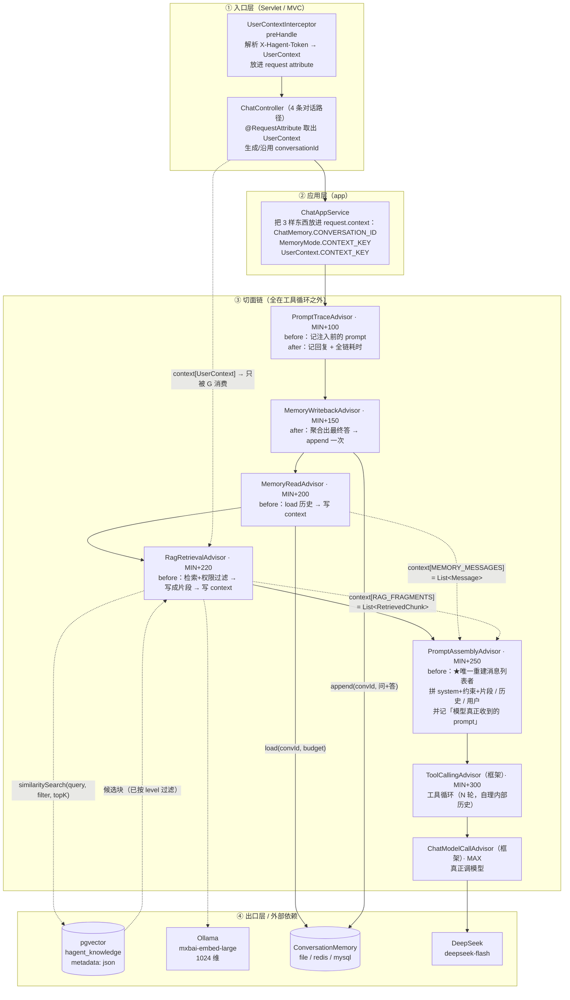

**三处标注的含义**（都是本轮定型、不能随意改的结构性质）：

| 标注 | 含义 | 改了会怎样 |
|---|---|---|
| **全部切面在 `MIN+300` 之前** | 在框架工具循环**之外** → 一次请求只被调用一次 | 写回变 N 次（污染历史）、检索变 N 次（成本 ×N）、拼装在循环内重建会丢 `tool_call` 消息 |
| **`G` 与 `R` 只写 context，不碰 prompt** | 让 `A` 成为唯一的"重建消息列表者" | 两个重建者互相覆盖，先注入的**静默消失**（实验 2 已证） |
| **`after` 顺序与 `before` 相反** | 洋葱式包裹：内层先返回 | `MIN+100` 的 after 最后执行（量到全链耗时）；`MIN+150` 的 after 落在它之前（写回结果能被日志记到） |

#### 本阶段核心对象结构

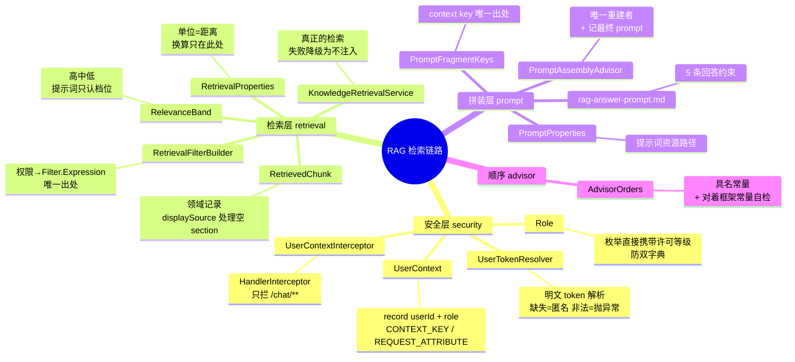

#### 本阶段目标

把已经入库的向量知识真正用起来，并把"谁在问"一路传到检索的 SQL 条件上：

1. **鉴权链路**：从自定义请求头解析身份 → 请求作用域 → 请求 context → 检索切面；
2. **检索链路**：向量检索 + **检索前**权限过滤（越权内容不离开数据库）；
3. **拼装链路**：把记忆、检索片段、回答约束、用户消息合成**一份** prompt；
4. **切面拆解**：把原来的 `ConversationMemoryAdvisor` 拆成"读"与"写回"两个切面 ——
   因为它们的位置要求相反，一个 order 装不下。

#### 本阶段价值（为什么做）

解答"每个组件解决什么问题、产出谁消费"（协议第 7 条）：

| 组件 | 解决什么问题 | 产出谁消费 | 不做会怎样 |
|---|---|---|---|
| `UserContextInterceptor` + `UserTokenResolver` | "谁在问"从请求头传到业务层 | `RagRetrievalAdvisor` 经 context 读 | 检索只有一种视角，要么全可见（越权）要么全不可见 |
| `RetrievalFilterBuilder` | 把"用户许可"翻成 SQL 的 `level IN (...)` | `SearchRequest.filterExpression` | 机密内容被取回、拼进 prompt、由模型复述 —— **越权且不留痕迹** |
| `KnowledgeRetrievalService` | 召回与问题相关的企业资料 | `RetrievedChunk` 列表 → 拼装 | 模型只能凭训练时的一般知识回答"年假几天"，与本司制度可能完全不符 |
| `MemoryReadAdvisor` | 把历史放进 context（不再自己重建 prompt） | `PromptAssemblyAdvisor` | 模型看不到上一轮说了什么 |
| `MemoryWritebackAdvisor` | 一次请求恰好把"问+答"落库一次 | 下一轮的 `MemoryReadAdvisor` | 历史永远为空；若在循环内则会写 N 次并污染历史 |
| `PromptAssemblyAdvisor` | 把四个来源合成一份 prompt | 模型 | 前面所有切面的产出**没有任何消费者** |
| `AdvisorOrders` | 顺序的唯一出处 + 可自检 | 全部切面 + `AdvisorOrderTest` | 顺序散成裸数字，改一处不知影响谁 |

#### 主要新增/涉及文件

**新增（主代码 13 个 + 资源 1 个）**

| 包 | 文件 | 作用 |
|---|---|---|
| `security` | `Role` | 角色 → 许可等级（策略跟着枚举走，防双字典） |
| `security` | `UserContext` | 身份 record + `CONTEXT_KEY` + `ANONYMOUS` |
| `security` | `UserTokenResolver` | 自定义 token 解析（缺失=匿名；非法=抛异常） |
| `security` | `UserContextInterceptor` | 拦截器，只拦 `/chat/**` |
| **`app`** | `KnowledgeRetrievalService` | 检索（失败降级为不注入，记 ERROR）。★ **Service 归 app** |
| **`config`** | `RetrievalProperties` | `hagent.rag.retrieval.*`；**单位=距离**，换算收口 |
| **`config`** | `PromptProperties` | `hagent.rag.prompt.*` |
| `retrieval` | `RelevanceBand` | 高/中/低档位（提示词只认档位，不认原始分数） |
| `retrieval` | `RetrievedChunk` | 检索命中的领域记录 + `displaySource()` |
| `retrieval` | `RetrievalFilterBuilder` | 权限 → `Filter.Expression`（唯一出处，空清单显式拒绝） |
| `advisor` | `AdvisorOrders` | 全部 order 具名常量 + 对着框架常量自检 |
| `advisor` | `PromptLogFormat` | 截断/单行化（追溯与拼装两个切面共用） |
| `advisor` | `PromptFragmentKeys` | context key 常量 —— **与它的使用者（三个切面）同包** |
| `resources` | `prompts/rag-answer-prompt.md` | 5 条回答约束 |

**新增切面（3 个）**：`MemoryReadAdvisor` / `MemoryWritebackAdvisor` / `RagRetrievalAdvisor` / `PromptAssemblyAdvisor`

**删除（1 个）**：`ConversationMemoryAdvisor` —— 拆成上面两个；理由见"踩坑记录"

**修改（8 个）**

| 文件 | 改了哪里、为什么 |
|---|---|
| `AccessLevel` | 新增 `visibleLevels()`：把 `visibleTo` 这条规则产出成"等级清单"，供 SQL 的 `IN` 用。**规则仍只有一个出处**（清单由 `visibleTo` 派生） |
| `AiConfig` | 注册 5 个切面并按 order 声明；`ChatClient` 增加 `PromptProperties` / 检索服务 / 约束资源三个参数 |
| `ChatAppService` | 4 条对话路径都接收并放入 `UserContext`；补写"方式一/二不带记忆"的准确含义 |
| `ChatController` | 4 个端点用 `@RequestAttribute` 取身份并下传 |
| `WebConfig` | 注册身份拦截器（`/chat/**`）；构造器注入 `UserTokenResolver` |
| `RagConfig` | 注册 `RetrievalProperties` / `PromptProperties`；新增"约束资源存在性"Bean（缺失即启动失败） |
| `PromptTraceAdvisor` | 截断逻辑抽到 `PromptLogFormat`；order 改为具名常量；**修正"能看到注入后 prompt"这一方向写反的注释** |
| `application.yml` | 新增 `hagent.rag.retrieval.*`（含单位说明与实测依据）与 `hagent.rag.prompt.*` |

#### 踩坑记录（只记有可迁移认知的）

**坑 1 ★★ 文档里的 `ToolCallingAdvisor` order 写错了（`+200` 实际是 `+300`），
而"错"的后果不是数字不同，是少了一个可用区间**

```text
javap -constants ...ToolCallingAdvisor
  public static final int DEFAULT_ORDER = -2147483348;   ← MIN_VALUE + 300
```

项目文档（`HANDOFF.md` / `WORKING-AGREEMENT.md` / 本节之前的 `PROCEDURES.md`）共 5 处
写成 `MIN_VALUE + 200`。差别在于：`MIN+201 … MIN+299` 这一段是
**"工具循环之外、且能被本项目使用"的空档**；按 `+200` 去算，很容易以为"没有位置可用"。

- **收获**：**引用框架常量而不是抄写数字**。`AdvisorOrders.TOOL_CALLING` 直接写
  `ToolCallingAdvisor.DEFAULT_ORDER`，`AdvisorOrderTest` 再断言它等于 `MIN_VALUE+300` ——
  框架一改，测试立刻失败并指出来。

**坑 2 ★★★ 切面链的 `after` 是 `before` 的镜像，旧注释把方向写反了**

旧注释（`AiConfig` / `ConversationMemoryAdvisor`）写着
"`traceAdvisor` order=0 在最外层，所以能看到**注入后**的完整 prompt"。**方向恰好相反。**

`DefaultAroundAdvisorChain.nextCall` 从队列 pop 出下一个切面、把 request 的新版本继续往下交，
**内层的修改不回流给外层**。所以最外层在 before 侧看到的永远是"还没被加工过"的那一版。

- **为什么当时没发现**：项目只有一个业务切面，而记忆切面自己的日志
  （`[记忆] 注入历史 N 条`）也能证明"注入发生了" —— 于是没人去核对
  "那行日志里的**消息数**对不对"。**两个各自都"看起来正常"的日志，掩盖了一个方向错误。**
- **处理**：日志拆成两条并各司其职 ——
  `PromptTraceAdvisor` 记"请求进链时的样子"，`PromptAssemblyAdvisor` 记"模型真正收到的 prompt"。
  `AdvisorOrderTest#outerAdvisorCannotSeeInnerInjection` 用断言把这条固化下来。
- **收获**：**"两个组件各自日志正常"不等于它们之间没有错。**
  要验证方向，必须有一个观察者同时看到两侧。

**坑 3 ★★★ 框架会探测"记忆切面是否在工具循环内层"，据此关掉自己的内部历史**

```java
// DefaultChatClient$DefaultChatClientRequestSpec#autoRegisterToolCallingAdvisor 字节码
boolean memInside = advisors.stream()
    .anyMatch(a -> a instanceof MemoryAdvisor && a.getOrder() > toolCallingAdvisorOrder);
advisors.add(toolCallingAdvisorBuilder.copy()
    .conversationHistoryEnabled(!memInside)      // ★ 反向
    .build());
```

而 `MemoryAdvisor` 是个**空标记接口**（`interface MemoryAdvisor extends Advisor {}`）。

`doGetNextInstructionsForToolCall` 的语义：开关为真 → 返回
`toolExecutionResult.conversationHistory()`（累积全部）；为假 → 只留
`List.of(systemMessage, 最新一条)`，把历史的维护**交给内层的记忆切面**。

- **本项目的状态**：`ConversationMemoryAdvisor` 只实现了 `CallAdvisor, StreamAdvisor`，
  **没有** `implements MemoryAdvisor` → 框架认为"内层没有记忆切面" →
  `conversationHistoryEnabled = true` → 框架自己累积完整历史。
- **如果当时按"把它标记成 MemoryAdvisor"去改**：框架会关掉内部历史、只发
  `system + 最新一条`，而我们的记忆只存"问 + 最终答"、**不存中间工具轮次** →
  阶段 8 工具循环会缺 `tool_result` 而失效。
- **收获**：**"实现一个看起来更专业的接口"可能是在把控制权交出去。**
  决定不实现 `MemoryAdvisor` 是有意的：我们只想要"单轮问答的记忆"，
  不想要"多步循环的记忆" —— 后者由框架自己管更合适。

**坑 4 ★★ 一个抽象如果"只有 before"或"只有 after"，它的位置仍然只有一个 —— 而两种功能的
位置要求可能相反**

`ConversationMemoryAdvisor` 同时做"读历史"和"写回本轮"，共用一个 `order=1`。但：

| | 位置要求 | 方向 |
|---|---|---|
| 读历史 | 必须在**拼装之前**（产出要被拼装消费） | 往内层推 |
| 写回本轮 | 必须在**整条链收尾**（要最终回复、要避开工具循环） | 往外层推 |

两条要求方向相反，挤在一个切面里只能二选一牺牲。**拆成两个切面后各自干净。**

- **收获**：**判据是"需不需要请求级业务数据"** —— 需要（读历史要 `conversationId`）→ 属于
  "这一次请求的编排"；不需要（日志、耗时）→ 属于"每次调用的横切"。
  这条线同时决定了"它能不能真·即插即用"：只有不需要请求级数据的切面才是插上就生效的。

**坑 5 ★ 把日志写进 `target/` 再执行 `clean` —— 构建自己把自己绊倒**

```text
[ERROR] Failed to clean project: Failed to delete ...\target\full-test-run.log
        （另一个进程正在使用此文件）
```

同一条命令里先 `clean` 删 `target/`，而输出日志正重定向到 `target/` 里 —— 文件被占用，清理失败。

- **收获**：**工具的产物不要和工具要清理的目录放一起。** 已改到 `tmp/`（已被 `.gitignore` 覆盖）。

**坑 6 ★ 检索失败会"伪装成没命中"**

`KnowledgeRetrievalService` 在检索失败时**降级返回空列表**（设计如此：检索不在关键路径上）。
于是一个**坏掉的过滤条件**（例如 jsonpath 在真实 pgvector 上不被接受）
与"知识库里确实没有相关内容"在结果上**完全一样**，都是空列表。

- **处理**：集成测试里特意加了一条"员工视角**必须**检索到 INTERNAL 内容"的断言 ——
  若过滤条件不可执行，那次查询会抛异常、被降级成空列表，这条断言立刻失败。
  **它同时验证了"过滤生效"与"过滤可执行"两件事。**
- **收获**：**降级路径必须有一条"正向断言"作对照。**
  只断言"失败时返回空"会把"永远返回空"也判成通过。

**坑 7 ★★★ `FilterExpressionBuilder.in` 的重载回退 —— 泛型不变导致的静默失效**

这是本阶段**实际踩到**的坑，根因比"两个重载行为不同"更隐蔽。

`javap` 实证，框架上有两个 `in` 重载：

```java
public Op in(String, Object...);        // 逐值展开 → OR 链
public Op in(String, List<Object>);     // ★ 参数是 List<Object>，不是 List<?>
```

关键在第二个的参数类型。**泛型是不变的** —— `List<String>` **不能**赋给 `List<Object>`：

```java
List<String> levelNames = visible.stream().map(Enum::name).toList();
new FilterExpressionBuilder().in("level", levelNames)
//  → List 重载【不适用】（List<String> 不是 List<Object>）
//  → 静默回退到 in(String, Object...)，把整个 List 当成【一个值】
//  → metadata::jsonb @@ '($."level" == ["PUBLIC","INTERNAL"])'::jsonpath
```

而正确写法的渲染是：

```java
new FilterExpressionBuilder().in("level", levelNames.toArray())
//  → metadata::jsonb @@ '($."level" == "PUBLIC" || $."level" == "INTERNAL")'::jsonpath
```

前者是拿**字符串**去和**数组字面量**比较，jsonpath 求值**恒为 `false`**。
后果：查询正常执行、正常返回，只是**一条都不命中** ——
**没有编译错误、没有警告、没有异常、没有 ERROR 日志**，表现是"检索功能好像没生效"。

**四种写法的实测渲染对照**（`RetrievalFilterSqlTest#inOverloadRenderingsArePinned` 固化）：

| 写法 | 渲染 | 结果 |
|---|---|---|
| `in(key, "PUBLIC", "INTERNAL")` | `($."level" == "PUBLIC" \|\| ...)` | ✅ |
| `in(key, List<String> 变量)` | `($."level" == ["PUBLIC","INTERNAL"])` | ❌ **静默失效** |
| `in(key, List<Object> 变量)` | `($."level" == "PUBLIC" \|\| ...)` | ✅ |
| `in(key, stringList.toArray())` | `($."level" == "PUBLIC" \|\| ...)` | ✅（本项目采用） |

★ 第 2 行与第 3 行**只差一个泛型声明**，结果完全相反 —— 这就是它最难被发现的地方。

**为什么原有的 `RetrievalFilterSqlTest` 没拦住它**：它只断言了
"生成的 SQL 不含 `@>` 与 `?`"（那是在防 `json` 列不支持 jsonb 操作符），
**没有核对渲染结果**。也就是说它验证的是"没用到错误的操作符"，
而不是"生成了正确的条件" —— **断言选错了对象，测试就给不了保护**。

**发现方式**：集成测试里那条正向断言 "员工视角**必须**检索到 INTERNAL 内容"。
若只有那些"匿名只能看到 PUBLIC"的反向断言，它们会在**空结果**上全部通过 ——
**一个坏掉的查询与一个安全的查询，在反向断言下看起来一模一样。**

**处理**（三处一起改，缺一不可）：
1. `RetrievalFilterBuilder` 改用 `levelNames.toArray()`，并写明根因；
2. `RetrievalFilterBuilderTest` 新增断言：**必须含 `||`，且不得含 `== [`**；
3. `RetrievalFilterSqlTest` 新增四种写法的渲染对照表，**刻意把错误行为也钉住** ——
   它的作用不是验证正确行为，而是把"这种写法会静默失效"变成**可执行的文档**。

- **收获 1**：**"过滤条件写错了"与"库里确实没有数据"在结果上完全一样。**
  凡是这类"失败与正常同形"的地方，都必须有一条**正向断言**（"必须查到"）作对照。
- **收获 2**：**重载 + 泛型不变 = 静默降级。**
  当重载的参数类型是 `List<Object>` 这类"看起来通用、实际很窄"的形状时，
  传一个 `List<String>` 不会报错，而是掉进另一个重载。
  **判据：凡是"传集合给重载方法"的地方，都要确认它命中了哪个重载** ——
  显式 `toArray()` 就是把意图写出来。

**坑 8 ★★★ 抛了 `IllegalArgumentException`，调用方的错被报成 500 —— 184 个测试都没抓到**

第一版 `UserTokenResolver` 对非法 token 抛 `IllegalArgumentException`。
当时 `UserTokenResolverTest` 10 个用例全绿、全量 177 个用例全绿。而真实 HTTP：

```text
POST /api/chat   X-Hagent-Token: badtoken
→ HTTP 500  {"code":50000,"message":"服务内部错误"}        ← ❌
修复后：
→ HTTP 400  {"code":40001,"message":"请求参数不合法"}      ✅
```

**根因**：`GlobalExceptionHandler` 里**没有** `IllegalArgumentException` 的处理器，
于是它落进 `Exception.class` 兜底 → 500。

★ **这正是 `PROCEDURES.md` 踩坑 #10 记录过的同一类问题**
（阶段 2：协议级异常因"没有显式处理器"被报成 500），
当时的结论是"**补异常分支要按『一类』补**"。本轮又一次踩在同一处 ——
区别只是换了一个异常类型。

**为什么整套测试都没抓到**：现有测试覆盖了"组件内部行为"与"真库链路"，
但**没有任何一个用例经过 MVC 的异常处理路径** ——
抛异常的那个类（`UserTokenResolver`）和把它翻译成 HTTP 响应的那个类
（`GlobalExceptionHandler`）**从未在同一个用例里同时出现**。
单元测试测的是"它抛了什么"，而缺陷在"抛出来的东西没人接"。

**处理**（三处）：
1. `UserTokenResolver` 改抛 `AgentException(ErrorCode.INVALID_PARAM, ...)` ——
   由既有的 `AgentException` 分支处理，不新增处理器；
   ★ **不给 `IllegalArgumentException` 加全局处理器**：它在 JDK 与框架内部到处被抛，
   加全局处理器会把**真正的程序错误也当成 400**，那是在掩盖 bug。
   正确做法是让"可归因于调用方"的异常**携带明确错误码**；
2. 分层保持不变：领域枚举（`Role`）继续抛 `IllegalArgumentException`（纯领域，
   不依赖 Web 错误码），由 `UserTokenResolver` 这个 **HTTP 边界组件**负责翻译 —— 翻译点只有一个；
3. **新增 `ChatEndpointIdentityTest`**：用 `@SpringBootTest(RANDOM_PORT)` + JDK 的
   `HttpClient` 发**真实 HTTP 请求**，断言"非法 token → 400 + 40001"。
   ★ 它把"抛出"与"HTTP 形态"放进同一个断言 —— 这正是缺失的那一层。

- **收获 1（协议第 3 条的老话，但这次有具体形状）**：
  **"单测全绿 ≠ 功能可用"不是一句口号，它是一个可定位的结构缺口**：
  当 A 类负责抛、B 类负责接时，测 A 的用例和测 B 的用例都通过，
  **而 A→B 这条边没人测**。写测试时要问："这条链路上，有没有一条边只被两端各自覆盖？"
- **收获 2**：**同一个坑会在不同异常类型上重演。**
  踩坑 #10 的教训是"按类补分支"，本轮**没有把它变成机制**，于是换了个异常又踩一次 ——
  这正是协议第 6 条说的"同一类操作性错误重复 ≥2 次必须机制化"。
  **待办**：加一条"凡是新增可抛出的异常类型，必须同时在 `GlobalExceptionHandler` 里有落点
  或明确说明它归入哪条既有分支"的检查（见"需要本人决策的事"）。
- **收获 3（诚实标注一个遗留）**：非法凭证语义上更接近 **401 Unauthorized**，
  而本项目错误码契约里没有 401（4xxxx 段只有参数/协议类）。
  当前用 400 表达"该改凭证、别重试"。**是否新增 401 语义的错误码属于契约变更，留给本人定。**

**坑 9 ★★ 包放错：把 `Service` 放进了领域包，破坏了既有的分层惯例**

第一版把 5 个类放进了（新造的）`retrieval` 包与 `prompt` 包：

```text
❌ retrieval/KnowledgeRetrievalService.java     ← 项目里所有 *Service 都在 app/
❌ retrieval/RetrievalProperties.java           ← RAG 领域的 ChunkingProperties / IngestProperties 都在 config/
❌ prompt/PromptProperties.java                 ← 切面参数 AdvisorProperties 在 config/
❌ prompt/PromptFragmentKeys.java               ← 3 个使用者全在 advisor/，却单独占一个包
```

**根因：本项目同时存在两套组织规则，而我没有先问"这个类属于哪一套"。**

<table border="1">
  <caption>同一棵树上的两套规则</caption>
  <tr><th>规则</th><th>适用对象</th><th>包</th></tr>
  <tr><td><b>按技术角色</b></td>
      <td>外壳 / 基础设施类：Service、Controller、DTO、配置、异常、切面</td>
      <td><code>app</code> / <code>controller</code> / <code>dto</code> / <code>config</code> /
          <code>exception</code> / <code>advisor</code></td></tr>
  <tr><td><b>按能力域</b></td>
      <td>领域模型与其内部组件：值对象、枚举、加载器、切分器</td>
      <td><code>document</code> / <code>document/chunking</code> / <code>memory</code> /
          <code>retrieval</code> / <code>security</code></td></tr>
</table>

**判据（写下来，下次先问）**：
- 类的**种类**有既定归属吗？（`*Service`→`app`、`*Properties`→`config`、`*Advisor`→`advisor`）
  → **有，就跟种类走**，不要跟"它讲的是哪个业务"走；
- 没有既定归属（值对象、枚举、能力内部 `@Component`）→ **跟能力域走**。

**核实手段（本次用的）** —— 不靠记忆，靠列出来看：
```powershell
Get-ChildItem -Recurse -Filter '*Service.java'     | 看它们都在哪个包
Get-ChildItem -Recurse -Filter '*Properties.java'  | 看它们都在哪个包
```
实测结果：`*Service` **3/4 在 `app/`**；`*Properties` **7/10 在 `config/`**。
一眼就能看出我那两个是破例。

**★ 顺带确认了一件事（避免过度纠正）**：`config/IngestProperties` **本身就 import
领域枚举 `com.hagent.document.DocumentKind`** —— 所以"配置类依赖领域"是本项目的既有模式，
不需要为了"解耦"把 `bandOf()` 挪进 `RelevanceBand`。**先确认惯例，再决定要不要重构。**

- **收获 1**：**"新代码放哪"不是风格问题，是"库里已有多少同类、它们在哪"。**
  下笔前跑一条 `Get-ChildItem -Filter '*Xxx.java'` 比自己想快得多，也准得多。
- **收获 2**：**一个能力被劈成两个包，是"放错"的典型信号。**
  `PromptAssemblyAdvisor` 在 `advisor/`、它读的 key 在 `prompt/` —— 这种"做事的在一处、
  约定在另一处"的劈裂，比包名难听严重得多。判据：**谁用它，它就跟谁走。**

**坑 10 ★★★ 响应方向的同款编码陷阱 —— "发出去了"又被当成"能看到"**

端到端验收时，我打出来的模型回复全是乱码：

```text
$resp.Content | ConvertFrom-Json   →  æ ¹æ®ãåå·¥æåã第äºç« ï¼...     ❌
```

**根因**：服务端响应头是 `application/json`（**不带 charset**，实测），
而 PowerShell 的 `Invoke-WebRequest` 在缺 charset 时**按 ISO-8859-1 解码响应体**。
按原始字节显式 UTF-8 解码就完全正确：

```text
UTF8.GetString($resp.RawContentStream 的字节)  →  根据《员工手册》第二章…   ✅
```

★★ **这是 `WORKING-AGREEMENT` §9.1 那个"请求方向"陷阱的镜像** ——
同一个"没有 charset 就按 ISO-8859-1"的默认值，**发送方向踩过、接收方向没踩**。

**为什么长期没被发现（这才是重点）**：
- `tools/hagent-test.ps1` 自己的注释写着"要确认发送是否正确，**看服务端日志**" ——
  **所有人工验证都是看服务端日志做的，没人读脚本返回的「回复」字段**；
- 而 `WORKING-AGREEMENT` §9.2 表里"响应出（JSON）✅ 中文完好"这个结论，
  是**对原始字节**验的（用 `TcpClient` 之类），**没验过"观察者能不能看到"**。

> ★ 这**正是协议第 3 条自己记录过的教训**：
> "曾断言'你应该能看到 retry 字段'，实际浏览器 EventSource 面板不展示帧级字段 ——
> **把「发出去了」误当成「能看到」**"。同一个错误换了一层，又犯一次。

**处置**：`tools/hagent-test.ps1` 里所有读响应的地方改为
**取原始字节 → 显式 `UTF8.GetString`**，收口到 `读响应体` / `读错误响应体` 两个函数
（失败响应 4xx/5xx 的错误信息同样会乱码，也一并改）。
细节与"以后怎么写"的规范进了 `WORKING-AGREEMENT.md` §9.2.1。

**★ 处置过程中的两个附带发现**：
1. **`edit` 类工具会剥掉 `.ps1` 的 BOM** —— 改完复验前 3 字节，果然变成非 BOM，
   已补回。这实证了协议第 9 条那句"用编辑器/工具重写该文件会剥掉 BOM，改完必须复查"。
2. **锚点要逐字节核对**：第一次改脚本时按"读到的样子"抄锚点，结果那几行实际是
   `# 文字`（我抄成了 `#     文字`），编辑直接不匹配。**改用 `ReadAllLines` 打印
   `[行内容]` 确认后才成功** —— 与"结论必须有证据"同源：连"这行长什么样"也要看真的。

- **收获**：**"发出去了"和"能看到"是两个独立的事实，必须分别验证。**
  本项目已经在 retry 字段上栽过一次；这次栽在响应解码上。
  凡是"数据正确但用户看到的不是它"的场景，都要问一句：**观察者那一段有没有人验过？**

**坑 11 ★★ 知识库文档之间自相矛盾，而"改了文档"不会自动生效**

模型**每次都**回答"资料之间存在冲突，我无法自行取舍"。根因不在代码，在**示例数据**：

| 文档 | 原始内容 | 冲突点 |
|---|---|---|
| `公司简介.md` | 二零一五年成立 / 约八十人 / 企业级**数据**服务 | 成立时间、人数、业务定位 |
| `公司介绍.md` | 二零零八年三月成立 / 三百二十七人 / 企业级**软件**服务 | 同上 |

两份都是 `COMPANY_PROFILE`、都被同一批提问命中 → 模型拿到两个互相矛盾的片段 →
（正确地）报冲突。**代价是用户觉得"这个知识库不可信"。**

**处置**：把「公司简介」改成「公司介绍」的**精简版**（事实一致、更短），
并**刻意控制在约 60 字** —— 它必须继续满足"恰好切成 1 块"的断言。

**★ 处理过程中我自己先犯了一个错，值得记**：第一版把"保持同步"的说明用
`<!-- -->` 注释写进了**文档正文** —— 而**正文会原样进入切块内容**：
既把字数从 62 推到近 400（可能触发切分、打破断言），又会让模型在检索片段里读到注释。
**说明要写在 `KNOWLEDGE-SAMPLE-DATA.md`，不能写在数据里。**

**★ 另一个真坑：改完文档不会自动生效。**
入库**没有 HTTP 入口**，`ingestAll()` 只在测试里被调用；而那个测试的逻辑是
"**库里已有数据就不再入库**"（为了不依赖前序状态）。
所以直接跑它**不会**把改过的文档写进去 —— 你会在"明明改了文档"的情况下
看到模型仍旧按旧内容回答，**且没有任何报错**。

```powershell
docker exec pgvector psql -U postgres -d hagent -c "TRUNCATE TABLE hagent_knowledge;"
.\mvnw.cmd -B -ntp test -Dtest=DocumentIngestStableStateTest   # 库为空才会 ingestAll
```

- **收获 1**：**知识库是"数据"，它的正确性不在代码测试的覆盖范围内。**
  189 个用例全绿也挡不住"两份文档说的不是一家公司" —— 这类问题只有**问一句真话**才能发现。
- **收获 2**：**"改了配置/数据"与"生效了"之间隔着一步。**
  凡是"改完要重启/重跑"的，都要问："不重跑会怎样？" —— 这里会**静默沿用旧内容**。

---

#### 阶段结果

**测试：189 个用例全绿**（`mvnw.cmd -B -ntp clean test`），本阶段新增 **9 个测试类 / 77 个用例**，
并把既有的 `RetrievalFilterSqlTest` 从 6 个用例扩到 7 个（新增 `in` 四种写法对照）：
`111 + 77 + 1 = 189`。

| 测试类 | 用例 | 覆盖什么 |
|---|---|---|
| `AdvisorOrderTest` | 6 | order 与框架常量的边界关系、before/after 镜像、"外层看不到内层注入" |
| `PromptAssemblyAdvisorTest` | 17 | 拼装的形状与顺序、片段格式、未知消息保留、options 不丢、资源缺失即失败 |
| `RetrievalPropertiesTest` | 11 | 距离↔相似度换算、分档边界、浮点容差、启动期校验 |
| `RetrievalFilterBuilderTest` | 10 | 三种角色的可见清单、SQL 形态、`in` 必须渲染成 OR 链 |
| `RetrievalFilterSqlTest` | 7 | 各条件渲染实测 + **`in` 四种写法对照**（含陷阱留档） |
| `RetrievalPermissionIntegrationTest` | 9 | ★ 真库端到端权限过滤 |
| `RetrievalScoreProbeTest` | 2 | 分数语义与阈值单位的实测探针 |
| `UserTokenResolverTest` | 11 | token 解析：缺失=匿名 / 非法=抛异常 / **异常必须带 4xxxx 错误码** |
| `ChatEndpointIdentityTest` | 6 | ★ **真实 HTTP 往返**：非法 token → 400 + 40001（补上"抛出→HTTP 形态"那条边） |
| `MemoryBudgetsTest` | 5 | ★ 预算表覆盖全部模式、每个模式读自己的配置项、**两个调用点拿到同一份预算**（回归防线，已用植入缺陷验证） |

#### 验证证据

**① 权限过滤 —— 端到端实测（`target/retrieval-permission-report.txt`）**

同一提问「年假要提前几天申请」、同一个库、同样 `topK=3`，三种视角的结果：

```text
--- 匿名（仅可见 PUBLIC）：3 条 ---
   相似度=0.6009  档位=中  密级=PUBLIC      出处=公司简介 第 1 块
   相似度=0.5936  档位=中  密级=PUBLIC      出处=公司介绍 第 1 块
   相似度=0.5705  档位=中  密级=PUBLIC      出处=公司介绍 第 2 块

--- 员工（可见 PUBLIC+INTERNAL）：3 条 ---
   相似度=0.7495  档位=高  密级=INTERNAL    出处=员工手册 第二章 假期管理
   相似度=0.6980  档位=中  密级=INTERNAL    出处=员工手册 第三章 薪酬与福利
   相似度=0.6934  档位=中  密级=INTERNAL    出处=员工手册 第四章 差旅与报销
```

**这张表同时证明了四件事**（每一件都是"不报错但会错"的类型）：

1. **过滤真的作用在检索上** —— 匿名那栏**一条 INTERNAL 都没有**；
2. **过滤条件在真实 pgvector 上可执行** —— 员工那栏**非空**。
   （若 jsonpath 在 `json` 列上不被接受，查询会抛异常、被降级成空列表 ——
   而"空列表"与"没命中"看起来完全一样，所以这条正向断言是必需的。）
3. **topK 名额没有被无权内容挤占** —— 匿名拿到的是 3 条 PUBLIC 文档，
   而不是"检索出 3 条机密、筛掉后一条不剩"。这正是"检索前过滤"相对"取回后筛选"
   的实质差别。
4. **相关度分档在真实数据上工作** —— 员工视角的 top-1 是 0.7495 → 【高】，
   其余落【中】；匿名视角最好的也只有 0.6009 → 【中】。

**② 分数语义与阈值单位 —— 实测（`target/retrieval-score-report.txt`）**

| 提问 | score（相似度） | 换算距离 = 1 − score | HANDOFF 3.5 记录的距离 |
|---|---|---|---|
| 年假要提前几天申请（相关） | 0.7495 | 0.2505 | 0.2168 |
| 出差住宿费能报多少（相关） | 0.7582 | 0.2418 | 0.2237 |
| 我们的年假怎么算？（相关） | 0.7369 | 0.2631 | 0.2514 |
| 公司总部在哪里（相关） | 0.8171 | 0.1829 | 0.2570 |
| 请假流程是什么（相关） | **0.5415** | **0.4585** | **0.4827** |
| **今天杭州天气怎么样（无关）** | **0.7402** | **0.2598** | **0.2883** |
| 帮我翻译这段英文（无关） | 0.6812 | 0.3188 | 0.3396 |
| 帮我写一封催款邮件（无关） | 0.6720 | 0.3280 | 0.3563 |
| 推荐几本好看的小说（无关） | 0.6643 | 0.3357 | 0.3819 |
| 红烧肉怎么做好吃（无关） | 0.5147 | 0.4853 | 0.5055 |

**两个结论**：

- `Document.getScore()` 是**相似度**（`1 − 余弦距离`），与 HANDOFF 3.5 的距离表吻合
  （误差 0.02~0.04，差异来自入库状态不同）。**这是"分档方向不能写反"的依据。**
- ★ **相关与无关的分布依然完全重叠**：相关的「请假流程是什么」距离 0.4585，
  而无关的「今天杭州天气怎么样」只有 0.2598 —— **无关的比相关的"近"得多**。
  **阈值挡不住无关问题，这条在本轮再次被实测确认。真正的兜底是提示词约束。**

**③ `similarityThreshold` 的单位 —— 实测**

传入 `similarityThreshold=0.70` 后只返回 `score=0.7495` 一条（`≥ 0.70`），
**证明它是"相似度下限"**（越大越严），与 `RetrievalProperties` 的换算方向一致。

**④ `in` 重载渲染对照（`target/in-overload-report.txt`）**

```text
① in(key, "PUBLIC", "INTERNAL")     → ($."level" == "PUBLIC" || $."level" == "INTERNAL")   ✅
② in(key, List<String> 变量)         → ($."level" == ["PUBLIC","INTERNAL"])                 ❌ 恒为假
③ in(key, List<Object> 变量)         → ($."level" == "PUBLIC" || $."level" == "INTERNAL")   ✅
④ in(key, stringList.toArray())     → ($."level" == "PUBLIC" || $."level" == "INTERNAL")   ✅
```

**② 与 ③ 只差一个泛型声明，结果完全相反** —— 详见"踩坑记录 坑 7"。

**⑤ 框架事实 —— 字节码实证（不是记忆）**

| 事实 | 证据来源 |
|---|---|
| `ToolCallingAdvisor.DEFAULT_ORDER = MIN_VALUE + 300` | `javap -constants` |
| `ChatModelCallAdvisor.getOrder() = Integer.MAX_VALUE` | `javap -c` |
| 每个切面自动建 observation，且 `order` 进标签 | `DefaultAroundAdvisorChain.nextCall` 字节码里的 `AdvisorObservationContext.builder().order(...)` |
| 链是单向转发：`callAdvisors.pop()` 后把 request 转交下一环 | `DefaultAroundAdvisorChain.nextCall` 字节码 |
| 框架探测内层有无 `MemoryAdvisor` 来决定自己的循环历史开关 | `autoRegisterToolCallingAdvisor` + `doGetNextInstructionsForToolCall` 字节码 |
| `mutate()` 会复制 prompt 与 context（`new HashMap<>(context)`） | `ChatClientRequest.mutate()` 字节码 |
| `in(String, List<Object>)` 的参数是 `List<Object>` 而非 `List<?>` | `javap -p FilterExpressionBuilder` |

**⑥ 真实 HTTP 往返 —— 四个用例（服务真实启动，`spring-boot:run`，端口 8123）**

| # | 请求 | 结果 | 说明 |
|---|---|---|---|
| ① | `X-Hagent-Token: badtoken`（无分隔符） | **HTTP 400** `{"code":40001}` | ★ **第一版这里是 500**，见"踩坑记录 坑 8" |
| ② | `X-Hagent-Token: zhangsan:ADMN` | **HTTP 400** `{"code":40001}` | 未知角色同样按客户端错误处理 |
| ③ | 不带 token（匿名） | **HTTP 502** `{"code":50005}` 模型服务认证失败 | 占位 key 必然失败；**能走到模型这一步，说明前面五层切面全部正常执行** |
| ④ | `X-Hagent-Token: zhangsan:EMPLOYEE` | **HTTP 502** `{"code":50005}` | 同上 |

③④ 的 502 不是缺陷 —— 它恰好是**最有力的证据**：链上每一环都跑通了，只差最后一步调用真实模型。

**⑦ ★★ 切面链的真实执行轨迹（从服务日志抓取，含权限差异）**

同一个提问「年假要提前几天申请」，两种身份的日志对比：

```text
--- 匿名 ---
[检索] 命中 3 条（topK=3 粗筛=距离<= 0.5）| 视角 userId=anonymous role=ANONYMOUS 可见密级=[PUBLIC]
[检索]   · 相似度=0.6009 档位=中 出处=公司简介 第 1 块
[检索]   · 相似度=0.5936 档位=中 出处=公司介绍 第 1 块
[检索]   · 相似度=0.5705 档位=中 出处=公司介绍 第 2 块
[PromptAssemblyAdvisor] ← 模型收到的 prompt | 消息数=2（system=1 历史=0 未知=0 用户=1）| 片段=3

--- 员工 ---
[鉴权] 已解析身份：userId=zhangsan role=EMPLOYEE → 可见范围=INTERNAL
[PromptTraceAdvisor][call] → 请求 | 消息数=1 | 内容=年假要提前几天申请          ← ★ 注意这里是 1
[记忆-读] 会话 6db1a112-… 模式=CONVERSATION 注入历史 0 条（预算 5000 token / 30 条）
[检索] 命中 3 条（topK=3 粗筛=距离<= 0.5）| 视角 userId=zhangsan role=EMPLOYEE 可见密级=[PUBLIC, INTERNAL]
[检索]   · 相似度=0.7495 档位=高 出处=员工手册 第二章 假期管理
[检索]   · 相似度=0.6980 档位=中 出处=员工手册 第三章 薪酬与福利
[检索]   · 相似度=0.6934 档位=中 出处=员工手册 第四章 差旅与报销
[PromptAssemblyAdvisor] ← 模型收到的 prompt | 消息数=2（system=1 历史=0 未知=0 用户=1）| 片段=3
```

**这段日志一次性证明了五件事**：

1. **权限过滤在真实链路上生效** —— 匿名视角的可见密级是 `[PUBLIC]`，
   员工是 `[PUBLIC, INTERNAL]`，命中的来源完全不同（公司简介/公司介绍 vs 员工手册）。
2. **★★ "外层看不到内层注入"被实时日志直接证实** ——
   同一个请求里 `PromptTraceAdvisor` 打 `消息数=1`，
   而 `PromptAssemblyAdvisor` 打 `消息数=2（system=1 … 片段=3）`。
   **坑 2 那条被写反的注释，不需要专门造实验就能证伪 —— 两条日志摆在一起就够了。**
   这也是把它们拆成两条日志的价值所在。
3. **拼装结果可见**：日志里完整打出约束 + `【知识库片段 1／来源：员工手册 第二章 假期管理／相关度：高】`
   + 块正文，说明片段格式与档位都正确落进了 prompt。
4. **记忆读取在真实链路上执行**（`注入历史 0 条` —— 新会话，符合预期）。
5. **★ 模型调用失败时没有写回** —— 日志里**没有** `[记忆-写]` 行。
   这实证了决策 5（先调模型、后写记忆）：失败调用**不留半截记录**。
   它是"副产品证据"：本来只是在验 4xx/5xx，却顺手验证了一条设计决策。

---

## 7. 会话记忆的双层重构（MySQL 记录层 + Redis 上下文层）

> ★ **本阶段是一次定位纠正，不是"再加一个实现"。**
> 阶段 5 把 `ConversationMemory` 做成了"一个接口 + 三个靠配置二选一的平级实现"
> （`file` / `redis`，`mysql` 预留）。**那个抽象装不下阶段 7 真正需要的东西**：
> "对话记录"与"模型上下文"不是一份数据的两种存法，而是**两个角色、需求相反**。

### 本阶段数据流向

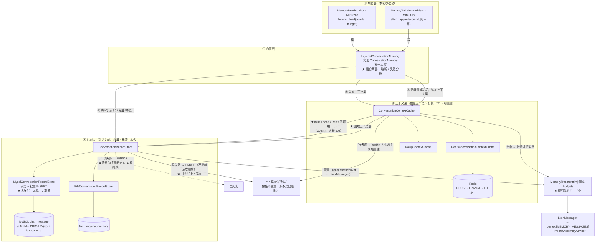

**三条不能弄错的性质**（与阶段 6 的切面顺序同等重要）：

| 性质 | 含义 | 破坏它的后果 |
|---|---|---|
| **先记录层、后上下文层** | 不变量：**上下文永不比记录新** | 出现"模型知道、用户刷新却看不到"的诡异状态 |
| **读先上下文、miss 才记录** | 上下文是**可丢的派生层** | 每轮都查库 → 上下文层失去意义 |
| **写失败分级** | 记录层失败=ERROR 但不影响响应；上下文层失败=WARN | 为写缓存失败丢掉已生成的回复（双重损失） |

### 本阶段核心对象结构

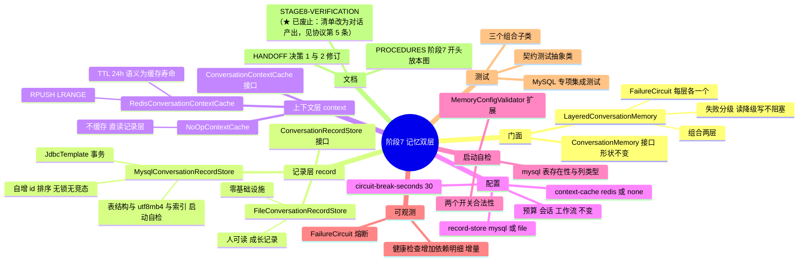

### 本阶段目标

把"一个接口三种平级实现"改成"**一个门面 + 两层各司其职**"：

- **记录层**（MySQL，权威·完整·永久）= 用户可见的对话记录。**不做预算裁剪** ——
  这正是"用户刷新页面能看到全部历史"的保证（将来给用户的历史读 API 直接读它）。
- **上下文层**（Redis，有损·TTL·可重建）= 模型这一次要用的上下文。
  miss 时从记录层重建，**权威永远在记录层**。
- **两层的关系是「派生」，不是「缓存同一份数据」** —— 这个区别决定了写路径是
  "两层各自写入"，而不是"写库后删缓存"。

### 本阶段价值（为什么做）

| 解决了什么 | 不做的后果 |
|---|---|
| 会话历史**永久**保留 | 阶段 5 的 Redis 实现带 24h TTL 且**它就是最终存储** → 用户第二天回来，历史**永久残缺**（不是"慢一点"，是"没了"） |
| 定位澄清 | 原设计容易被读成"同一份数据存两份" → 于是导出"写时删缓存"这种**命中率≈0**的无意义策略 |
| 上下文层承载"不该进用户记录"的东西 | 阶段 8 的工具中间态、本轮检索片段是**执行态**，写进对话记录会污染用户看到的历史 |

### ★ 接口命名约定（跨阶段复用）

> 这一节回答"**为什么记忆的三个接口方法名不一样**"。
> 它不属于某个阶段 —— 记忆这块抽象一旦定型就一直适用；放在这里，是因为这个问题在阶段 7 被提出。
> **同一份规则已写进三个接口的类注释**（正文在 `ConversationMemory`，另两个接口给指针 + 本层差异），
> 这里留一份便于回看与复用。

**背景**：三个接口的方法集合是

| 接口 | 方法 |
|---|---|
| `ConversationMemory`（门面） | `append` / `load` / `clear` / `delete` |
| `ConversationRecordStore`（记录层） | `append` / `readLatest` / `clear` / `delete` / `probe` |
| `ConversationContextCache`（上下文层） | `get` / `append` / `replace` / `evict` / `probe` |

**看起来乱，其实是四条判据的结果**：

**① 读：按「给谁用 + 能不能失败」分名**

| 方法 | 在哪层 | 参数 | 返回 | 语义 |
|---|---|---|---|---|
| `load` | 门面 | `TokenBudget` | 必定非 null，**已裁剪** | 给模型**这一次要用的那一份** |
| `readLatest` | 记录层 | `int` 条数上限 | 非 null，**未裁剪** | 库里最近的 N 条（**存储视角**） |
| `get` | 上下文层 | `int` 条数上限 | **可为 null** | 缓存里有没有（**缓存视角**） |

★ **收 `TokenBudget` 的地方会裁剪，收 `int` 的地方不会** —— 参数类型本身就是给调用点的提示；
而**只有缓存层能返回 `null`**，因为"未命中"是它的正常状态，不是异常。

**② 写：三层同名 `append`**

语义确实是同一个；差别在**失败强度**，由各层注释与门面的失败分级表达 ——
记录层必须成功且整批原子，缓存层允许失败（下次可从记录层重建）。
**名字表达"做什么"，强度另行表达。**

**③ 删：按「是否承载会话身份」分名**

- 记录层 `clear`（清空内容、会话还在）+ `delete`（整个会话删掉）—— 它**承载"会话"这个身份**，
  而这两件事对用户是不同的语义（"换个话题" vs "删掉我的数据"）；
- 缓存层只有一个 `evict` —— 它**不承载身份**，丢 key 就是丢 key。
- ★ **这个不对称本身就是信息**：它告诉你"这一层不管会话身份"。

**④ `replace` 只属于可丢的那一层**

重建路径的语义是"本层现在应当等于记录层说的内容"，用 `append` 会把残留旧内容**叠加**上去；
而记录层**故意没有** `replace` —— 整体替换权威对话记录**没有语义**（那就是数据丢失）。
**它的缺席是特性，不是遗漏。**

**★ 一处刻意的借鉴**：上下文层的 `get` / `evict` 直接对齐 Spring 的
`org.springframework.cache.Cache`（`get` 未命中返回 null、`evict` 丢一个 key）。
懂那套 API 的人一眼就懂语义 —— **能借用成熟惯例时不要发明新词**。

**★ 这一节为什么值得写下来**：规则如果不写出来，下一个人（或下一轮）**必须再问一遍**，
才能知道这些名字是有意的还是随手起的。本项目别处的设计理由都进了注释，命名不该是例外。

### 主要新增/涉及文件

| 类别 | 文件 | 作用 |
|---|---|---|
| 新增 | `memory/LayeredConversationMemory.java` | 门面实现：组合两层 + 时序 + 失败分级 |
| 新增 | `memory/FailureCircuit.java` | 短熔断窗口（两个使用者，故抽出） |
| 新增 | `memory/record/ConversationRecordStore.java` | 记录层接口 |
| 新增 | `memory/record/MysqlConversationRecordStore.java` | ★ 本阶段主体 |
| 新增 | `memory/context/ConversationContextCache.java` | 上下文层接口 |
| 新增 | `memory/context/NoOpContextCache.java` | `context-cache: none` |
| 新增 | `resources/db/chat_message.sql` | DDL 唯一出处（手动执行一次） |
| 改造 | `FileConversationMemory` → `FileConversationRecordStore` | 转为记录层实现 |
| 改造 | `RedisConversationMemory` → `RedisConversationContextCache` | 转为上下文层实现 |
| 修改 | `ConversationMemory` / `MemoryProperties` / `MemoryConfig` / `MemoryConfigValidator` / `ChatMemoryAdapter` / `application.yml` / `HealthAppService` | — |
| 删除 | `memory/InMemoryConversationMemory.java` | **死代码**：无 Bean、无配置入口、无任何测试引用 |
| 测试 | 契约测试抽象类 + 3 个组合子类 + MySQL 专项集成测试 | 见下 |

### 踩坑记录（只记有可迁移认知的）

**坑 12 ★★★ 业务主库的数据源从来就不存在 —— 而它被写进了三处注释**

阶段 7 第一次真正访问 MySQL 时，启动直接失败：

```text
DataSourceAutoConfiguration.PooledDataSourceConfiguration:
  Did not match:
  - @ConditionalOnMissingBean (types: javax.sql.DataSource, javax.sql.XADataSource)
    found beans of type 'javax.sql.DataSource' pgVectorDataSource     ← 自动配置被顶掉
```

**根因**：`VectorStoreConfig` 为了让 `PgVectorStore` 不抢到 MySQL 连接，
声明了 `pgVectorDataSource`。而**用户配置先于自动配置注册**，
`DataSourceAutoConfiguration` 的 `@ConditionalOnMissingBean(DataSource.class)` 于是不满足 →
**它退避了，业务主库的数据源根本不存在**。

★★ **后果**：`application-local.yml` 里那一整段 `spring.datasource.*`
（url / 账号 / Hikari 池参数）**一直被静默忽略**。而三处注释都写着
"本项目的全局 DataSource 是业务主库 MySQL"——**那句是 false**。

**为什么长期没暴露**：阶段 7 之前**没有任何代码使用业务主库**。没有消费方，就没有症状。

> ★ 这正是本项目第 7 条一直在防的那类问题：
> **不是写错了代码，而是没意识到这段配置根本没有被使用。**
> 也说明"修 A 引出的 B"可能安静地潜伏很久 —— 因为 B 还没有消费者。

**处置**：新增 `config/BusinessDataSourceConfig` 显式声明业务主库数据源并标 `@Primary`。
两个数据源的失败策略保持相反（MySQL fail-fast、pgvector 放开），这是有意的。

- **收获 1**：**当应用里出现第二个数据源时，"默认的那个"会消失，而且不报错。**
  全靠自动装配的配置，在引入第二个同类 Bean 的那一刻就可能失效。
- **收获 2**：**"某段配置一直在生效"是需要证据的断言。**
  条件评估报告（`--debug` 或失败时的 condition report）能直接给出"匹配/未匹配 + 原因"，
  比读代码猜快得多。

**坑 13 ★★★ `@Primary` 压过"按参数名匹配" —— 症状指向完全错误的方向**

给业务主库加上 `@Primary` 之后，向量库立刻启动失败：

```text
Creating bean 'vectorStore': bad SQL grammar [CREATE EXTENSION IF NOT EXISTS vector]
  → You have an error in your SQL syntax ... near 'EXTENSION IF NOT EXISTS vector'
     for the right syntax to match your MySQL server version
```

**误导性**：这句话读起来像"PostgreSQL 版本太老，不支持 `CREATE EXTENSION`"。

**真相**：`PgVectorStore` 拿到的 `JdbcTemplate` **连着 MySQL**。链路是：

```text
VectorStoreConfig.pgVectorJdbcTemplate(DataSource pgVectorDataSource)
     ↑ 参数名叫 pgVectorDataSource，看起来万无一失
但按类型解析时有两个候选，而业务主库标了 @Primary
     → 实际注入的是【MySQL 数据源】
     → 于是这个"pgvector 专用"的 JdbcTemplate 其实连着 MySQL
```

★★ **规则：`@Primary` 的优先级高于参数名匹配。** 参数名只在"没有 primary"时用来打破平局。
本项目此前多处依赖"参数名恰好对"这个隐式约定，它们一直是脆的。

**处置**：所有 pgvector 注入点（`VectorStoreConfig` 三个 Bean、`DocumentIngestService`、
三个集成测试的字段）全部改成 `@Qualifier` 按名取；
并新增 `MemoryWiringTest` 断言"两个数据源各指各的库、`pgVectorJdbcTemplate` 指向 PostgreSQL"
——把这条规则钉成**回归防线**，而不是留在注释里。

- **收获**：**有歧义的地方按名取，让"用哪个"在代码上看得见。**
  一个"猜错的注入"与"猜对的注入"在代码上一模一样，只有运行时才分得开。

**坑 14 ★★★ 为一个没人消费的属性，付了锁与死锁的代价**

表最初多一列 `seq`（会话内序号，从 1 开始、无洞）+ 唯一键 `uk_conv_seq`，
理由是"排序与分页都靠它，唯一键还能挡住序号撞车"。追加流程是"读 `MAX(seq)` → 插入"。

**实测把两条修法都否掉了** —— 而且是被测试逼出来的，不是推演出来的：

| 修法 | 结果 |
|---|---|
| 普通读 + 撞车重试 | ★ **重试被耗尽**：REPEATABLE READ 下普通读是*一致性读、不加锁*，并发事务必然读到同一个 MAX。实测 2 线程各追加 3 次就让 3 次重试全部用光，报"本轮未落库" |
| 锁定读 `FOR UPDATE` | ★ **死锁**：空区间上取*间隙锁*，而 INSERT 又要申请插入意向锁 → `CannotAcquireLockException` |

★★ **关键一问：`seq` 提供的属性，到底谁消费？**

| 用途 | 答案 |
|---|---|
| 排序 | `id`（自增主键）天然提供，且无竞态 |
| 分页游标 | `id` 更好 —— keyset（`AND id < ?`）比 seq 偏移更稳 |
| "会话内第 N 条" | ★ **没有任何消费者** |

**⇒ 为一个没人要的属性，付出了额外的锁、两种失败模式，以及"耗尽重试就丢一轮对话"。删掉。**

**处置**：表改为 `PRIMARY KEY (id)` + `KEY idx_conv_id (conversation_id)`；
应用层不再有 MAX 查询、不再有重试循环。读路径 `WHERE conversation_id=? ORDER BY id DESC LIMIT n`
正好是 `idx_conv_id` 的反向扫描（InnoDB 二级索引自动附加主键，实际按 `(conversation_id, id)` 有序）。

- **收获 1**：**引入一个"更规整"的属性（无洞序号、有序编号…）之前，先问谁消费它。**
  如果答案是"排序能用上"，那通常已经有更好的东西在提供它了。
- **收获 2**：**代价要算全。** "无洞"这两个字听起来是质量，实际成本是锁、死锁与丢数据风险 ——
  而收益是零。

**坑 15 ★★ 并发用例是"设计缺陷探测器"，不是"稳定性负担"**

那条并发用例最初写成 2 线程 × 3 次，第一次跑就失败了 —— **它抓到的不是测试问题，是设计问题**。

★ 值得记的是**当时最容易做错的反应**：看到失败，最容易的处置是
"把并发度调低"或"删掉这条 flaky 用例"。那样缺陷会留给生产，
而且生产上的表现是"偶尔丢一轮对话、没有任何报错"。

**处置**：不降并发度，**升到 4 线程 × 5 次**（比原来更狠），然后去修设计。
修完连跑两遍，稳定通过。

- **收获**：**一个刚写出来就失败的测试，先假设"它是对的、代码是错的"。**
  尤其是并发用例 —— 它失败时说的话，往往比它通过时更有价值。

**坑 16 ★★ 同一个引号坑踩了两次 —— 于是把它机制化**

想在容器里跑一条 SQL，最自然的写法是：

```powershell
docker exec hagent-mysql sh -c 'mysql -uroot -p"$MYSQL_ROOT_PASSWORD" -e "SELECT 1"'
#                                                                        ^^^^^^^^^^^
```

★ PowerShell 5.1 传参时会**吃掉内嵌的双引号** → 容器里的 `sh` 收到**空参数** →
mysql 报 `ERROR 1064 (42000) at line 1: ... near '' at line 1`。

**这个报错极具误导性**：它读起来像"SQL 写错了"或"MySQL 没起来"，
而真实原因是**参数根本没传到**。本项目因此误判过**两次**：

- **第一次**：以为命令写错，反复调引号，最后改成"文件 + 容器内重定向"才通；
- **第二次**（本阶段）：拿它做"容器是否就绪"的探针，得出 **"MySQL 60 秒内未就绪"的错误结论** ——
  而同一时刻容器日志里明明写着 `ready for connections`。
  ★ 这次的代价是：**我向本人报了一个错误的诊断**，本人还要反过来纠正我。

⇒ **已机制化（协议第 6 条）**：新增 `tools/sql.ps1`，提供
`查依赖`（三个容器在不在）/ `查MySQL` / `查PG`，
统一走"写**无 BOM** 的 `.sql` → `docker cp` → **容器内重定向**"这条路径 ——
**PowerShell 完全不参与文本编码，也没有引号会被吞**。

- **收获 1**：**一个"看起来像 A 但其实不是 A"的报错，值得花时间把它变成"看起来就是 A"。**
  这条坑修的不是 SQL，修的是**报错的可解释性**。
- **收获 2**：★★ **同一个操作性错误第二次出现时，不要只是"这次注意"。**
  第一次我把它写进了文档（当时的阶段 7 验收清单 §1.2 明确警告过这个写法），
  **然后我自己又踩了一次** —— 说明"写进文档"对操作者不构成约束。
  **只有把它变成工具，才算真的修掉。** 这是协议第 6 条的一次实证。

### 阶段结果

**测试：239 个用例全绿**（`mvnw.cmd -B -ntp clean test`），本阶段从 189 增至 239（**+50**）：

| 测试类 | 用例 | 覆盖什么 |
|---|---|---|
| `ConversationMemoryContractTest`（抽象） | — | 契约：10 条对外语义断言 |
| `FileNoOpContractTest` / `MysqlNoOpContractTest` / `MysqlRedisContractTest` | 10 / 10 / 12 | ★ 三种层组合跑**同一套**契约；最后一个额外验"清空 Redis 后仍能重建" |
| `MysqlConversationRecordStoreTest` | 6 | 索引与字符集自检、**并发不丢**、id 顺序、原子批写、extra 保 NULL |
| `FileConversationRecordStoreTest` | 11 | 文件记录层：原子写、跨实例重读、隔离、clear/delete |
| `MemoryWiringTest` | 4 | ★ 装配断言：两个数据源各指各的库、`pgVectorJdbcTemplate` 必须是 PostgreSQL |
| `MemoryConfigValidatorTest` | 6 | 两个开关的取值校验、旧 `type` 键必须明确报错 |
| `FailureCircuit` 相关 | — | 经门面行为覆盖（熔断窗口在测试中设为 0） |

**代码**：新增 7 个类 / 改造 2 个 / 删除 3 个旧实现；`application.yml` 的配置键由 1 个变 2 个。

### 验证证据

**① 装配（`MemoryWiringTest` 的实测输出，来自 surefire 报告）**：

```text
[装配证据] DataSource dataSource         -> jdbc:mysql://localhost:3307/hagent?...
[装配证据] DataSource pgVectorDataSource -> jdbc:postgresql://localhost:5432/hagent
[装配证据] JdbcTemplate pgVectorJdbcTemplate -> jdbc:postgresql://localhost:5432/hagent
```

★ 这三行同时证明了坑 12 与坑 13 已修复：业务主库真的存在了，且向量库的
`JdbcTemplate` 不再被 `@Primary` 劫持。**在此之前，第一行根本不存在。**

**② 并发用例真的逼出了设计缺陷**：

```text
（改之前，2 线程 × 3 次）
MysqlConversationRecordStoreTest.concurrentAppendsProduceContiguousSeq
  ? Execution java.lang.IllegalStateException: 会话 ... 连续 3 次 seq 撞车，本轮未落库

（改成锁定读之后）
  ? Execution org.springframework.dao.CannotAcquireLockException:
      PreparedStatementCallback; SQL [INSERT INTO chat_mess...
```

两条失败各否定了一种方案，最终导出"删掉 seq、用 id 排序"。
**修改后（4 线程 × 5 次，加压）连跑两遍：`Tests run: 48, Failures: 0, Errors: 0`。**

**③ utf8mb4 实测（建表后直插 emoji 与生僻字再读回）**：

```text
content: 😀𠮷 中文测试
HEX    : F09F9880 F0A0AEB7 20 E4B8AD E69687 E6B58B E8AF95
         └─4字节─┘ └─4字节─┘    └───── 中文测试 各 3 字节 ─────┘
```

**④ 表结构自检（应用启动时核对的三件事）**：

```text
[记忆-记录-mysql] 启动自检通过：表=chat_message content 字符集=utf8mb4 索引=idx_conv_id
```


---

## 待推进

- 工具调用与多步 Agent：反射注册工具、工具分组（最小权限）、状态机 + 循环 + 中断续跑
  - ⚠️ **不要再做"前置意图提取层"** —— 该设计已撤回，理由见 [5.3](#53-一个被撤回的坑前置意图提取层)。
    工具选择交给模型的原生工具调用能力（框架的 `ToolCallingAdvisor` 已自带循环）
  - **"不可逆操作需要确认"要做在工具执行层**（代码级强制），而不是靠模型自述"我需不需要确认"
- 双层记忆的长期记忆部分：`.md` 文件 + 索引（会话记忆部分已在阶段 5 完成）
- 前端极简页面：用 `EventSource` 真实消费 SSE，验证过程可视化
- 可观测性：关键路径耗时 / 成功率 / 工具调用计数；顺带处理流式失败时日志刷屏的问题
- **流式端点的记忆覆盖**：目前只有方式三（`/stream-sse`）带记忆。
  方式一/二刻意不带（它们是流式机制的对照实验），但如果后续把某一条提升为产品路径，需要重新评估
- **一个待补的验证**（不是新功能，是欠的证据）：`docs/STAGE5-VERIFICATION.md` 里的"下一轮能否答出名字"
  至今未跑 —— 目前只能证明记忆能装配、能落盘，**不能证明注入后模型真的用上了**
