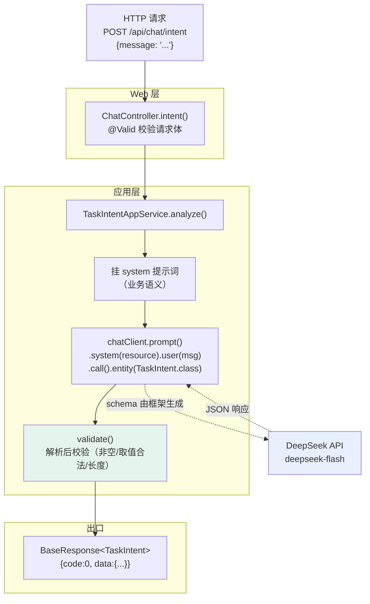
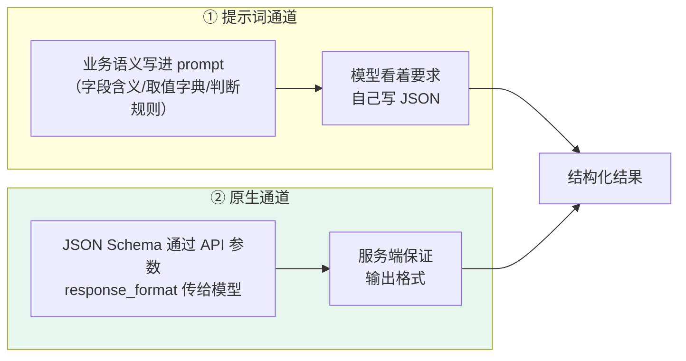
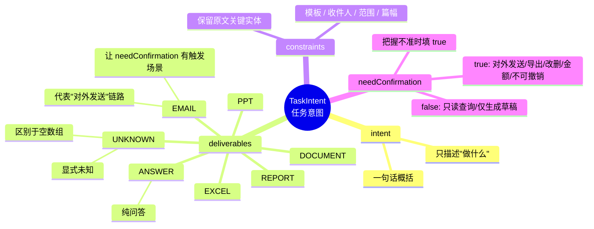

# Hagent

## author: Rong

## 项目目标（当前阶段）

一个**高扩展性的企业办公 Agent**，以 Spring Boot + Spring AI 为底座，按"能力可替换、配置可切换"的方式组织代码。

当前已完成：
- 工程骨架 + 启动探针（自动核对模型/密钥/存储装配是否符合预期）
- 模型接入（chat 用 DeepSeek 云端，embedding 用 Ollama 本地）
- 同步对话与流式对话（SSE）两条链路
- 统一契约（统一响应包装 / 全局异常 / 错误码）

规划中：
- RAG 企业知识库（手工检索链路 + 可替换向量存储）
- 工具调用与多步 Agent（状态机 + 中断续跑）
- 双层记忆（会话记忆多实现可切换 + .md 长期记忆）
- 过程可视化与办公产出（PPT / 邮件）

---

## 目录结构（当前）

```text
Hagent/
├── docs/
│   ├── PROCEDURES.md                    本文件（按阶段记录目标/文件/踩坑/结果）
│   └── WORKING-AGREEMENT.md             协作协议（推进流程、汇报格式、验证原则）
├── src/main/java/com/hagent/
│   ├── HagentApplication.java           启动类
│   ├── advisor/
│   │   └── PromptTraceAdvisor.java      调用链日志切面
│   ├── app/
│   │   ├── ChatAppService.java          对话业务编排（同步 + 流式）
│   │   ├── TaskIntentAppService.java    任务意图理解（结构化输出）
│   │   └── HealthAppService.java        健康检查业务
│   ├── common/
│   │   ├── BaseResponse.java            统一响应体
│   │   ├── ErrorCode.java               错误码枚举（分段 + 预留）
│   │   └── GlobalResponseBodyAdvice.java 统一响应包装器（含 SSE 放行）
│   ├── config/
│   │   ├── AdvisorProperties.java       切面参数（日志截断等）
│   │   ├── AiConfig.java                ChatClient 装配 + 提示词资源 Bean
│   │   ├── StreamProperties.java        SSE 参数（超时/心跳/重连间隔）
│   │   ├── VectorStoreConfig.java       向量库装配（含表名自检）
│   │   ├── VectorStoreDataSourceProperties.java
│   │   ├── VectorStoreProperties.java
│   │   ├── WebConfig.java               CORS 白名单
│   │   └── WebProperties.java
│   ├── controller/
│   │   ├── ChatController.java          同步 + 流式对话接口
│   │   └── HealthController.java        健康检查接口
│   ├── dto/
│   │   ├── ChatRequest.java
│   │   ├── ChatResponse.java
│   │   └── TaskIntent.java              任务意图（含 Deliverable 枚举）
│   ├── exception/
│   │   ├── AgentException.java          业务异常基类
│   │   └── GlobalExceptionHandler.java  全局异常处理器
│   ├── observability/
│   │   └── StartupProbe.java            启动探针
│   └── stream/
│       ├── StreamEventType.java         SSE 事件名唯一出处
│       └── SseSupport.java              流式放行判定
├── src/main/resources/
│   ├── application.yml                  主配置（进仓库）
│   ├── application-local.yml.example    私有配置模板
│   ├── prompts/
│   │   └── task-intent-prompt.md        任务意图的业务语义提示词
│   └── static/
│       └── stream-demo.html             流式三种实现的对比页
└── src/test/java/com/hagent/
    └── stream/SseSupportTest.java       放行判定回归测试
```

---

## 进度记录

> 章节号与项目阶段号对齐（阶段 0 起）。编号中跳过"阶段 4"是因为
> 手册里的阶段 4（手写 Advisor）已在阶段 1 用 `PromptTraceAdvisor` 完成。

## 0. 初始化项目

### 本阶段目标

- 建立可构建、可启动的工程骨架（Maven Wrapper + 包结构 + 配置分层）
- 把"环境是否真的可用"从猜测变成有证据的结论
- 确定所有关键依赖版本，避免后续返工

### 本阶段价值（为什么做）

- 骨架与配置分层是后续所有能力的地基；配置分层能让"本地私有配置（含密钥）"与"可提交配置"彻底分开
- 启动探针让"模型/密钥/存储装对了没有"变成**启动时自动核对**，而不是等出问题才回头查
- 版本决策一旦定错（如误用里程碑版），后期升级会牵连大量代码

### 主要新增/涉及文件

- `pom.xml`
  - 本阶段新增
  - 全部依赖使用**最新 GA 稳定版**：Spring Boot 4.1.1、Spring AI 2.0.1（不用 `-Mx` 里程碑版：API 未冻结、无安全维护）
  - 通过 `spring-ai-bom` + `<scope>import</scope>` 统一管理所有 `spring-ai-*` 模块版本
    - 理由：Spring AI 有几十个模块，逐个写版本号必然出现"模块间版本不匹配"
  - 显式声明 `annotationProcessorPaths`（Lombok）
    - 理由：明确告诉编译器"这个 jar 是拿去生成代码的，不是拿去运行的"（JSR-269），并锁定处理器版本
  - 作用：定义项目可用的全部依赖，且每处版本选择都写明理由

- `src/main/resources/application.yml`
  - 本阶段新增（主配置，可提交）
  - `spring.ai.model.chat=deepseek` / `spring.ai.model.embedding=ollama`
    - ★ 能力归属声明：两个模型 starter 同时存在时会各建一个 `ChatModel` Bean，导致启动失败；
      用 `@Primary` 只是让冲突消失，**没有表达"chat 用云端、embedding 用本地"这个设计意图**
  - `spring.ai.deepseek.chat.options.model=deepseek-flash`
    - 实测该账号可用模型只有 `deepseek-flash` / `deepseek-v4-pro`；`deepseek-chat` 等名字**不存在**
  - `spring.ai.deepseek.chat.options.reasoning-effort=HIGH`
    - `deepseek-flash` 本身是推理模型；枚举只有 HIGH / MAX，不用 MAX（更慢更贵）
  - 刻意**不设** `temperature`：推理模式下服务端会忽略采样参数（配了不报错但不生效）
  - `hagent.*` 命名空间下集中所有可调参数（探针开关 / agent 步数 / SSE 超时 / CORS 白名单 / 记忆目录 / 向量库数据源）

- `src/main/resources/application-local.yml.example`
  - 本阶段新增（模板，可提交）
  - 说明哪些配置属于私有（数据库密码、API Key），以及用环境变量注入的方式
  - 作用：新人拿到仓库后知道要建一份 `application-local.yml` 并填什么

- `src/main/java/com/hagent/HagentApplication.java`
  - 类：`HagentApplication`
  - 方法：
    - `main(String[])`：启动入口
  - 作用：`@SpringBootApplication` 三注解组合的落点；**必须放在根包**（`@ComponentScan` 只扫本包及子包）

- `src/main/java/com/hagent/observability/StartupProbe.java`
  - 类：`StartupProbe`
  - 方法：
    - `onReady()`：监听 `ApplicationReadyEvent`，应用就绪后自动执行一次探测
    - `runProbe()`：幂等执行入口（`AtomicBoolean` 兜住重复调用，避免健康检查轮询反复真调模型）
    - `probeChat()`：真调一次 chat，并**核对响应里实际返回的模型名**
      - 理由：请求不存在的模型名时 API 会静默降级且不报错，只核对"我配置了什么"发现不了
    - `probeEmbedding()`：真调一次 embedding，**实测维度**
    - `probeRedis()`：Redis 连通性
    - `probeVectorStore()`：直查 `information_schema` 确认 vector 扩展与库归属
    - `rerun()`：供 `/health/detail?refresh=true` 手动重跑
  - 作用：把"我以为装配对了"变成**可复现的实测结论**

- `src/main/java/com/hagent/config/VectorStoreConfig.java`
  - 类：`VectorStoreConfig`
  - 方法：
    - `pgVectorDataSource(...)`：创建 pgvector 专用 `DataSource`（**不标 `@Primary`**，业务主库仍是 MySQL）
      - `initializationFailTimeout(-1)`：向量库不可用不阻断启动（检索降级即可）
    - `vectorStore(...)`：**显式**装配 `PgVectorStore`，把表名/维度/索引类型等从配置绑定进来
    - `vectorTableSelfCheck(...)`：启动自检，直查库确认"实际表名 == 配置表名"
  - 作用：解决"pgvector 自动装配复用全局 DataSource（=业务主库 MySQL）"的归属问题

- `src/main/java/com/hagent/config/VectorStoreDataSourceProperties.java`
  - 类：`VectorStoreDataSourceProperties`
  - 作用：绑定 `hagent.vectorstore.datasource.*`（独立前缀，不与 `spring.datasource` 混用）
  - 字段默认值只是"属性缺省时仍可启动"的兜底；**真实取值一律以 application.yml 为准**

- `src/main/java/com/hagent/config/VectorStoreProperties.java`
  - 类：`VectorStoreProperties`
  - 作用：自己绑定 `spring.ai.vectorstore.pgvector.*`
  - 为什么需要：选择显式装配 `PgVectorStore` 后，官方的属性类不会被创建，配置项就无人读取

- `src/main/java/com/hagent/common/BaseResponse.java`
  - 类：`BaseResponse<T>`（record）
  - 方法：
    - `success(T)` / `success()` / `failure(ErrorCode)` / `failure(ErrorCode, String)`
    - `isSuccess()`：标 `@JsonIgnore`
      - 理由：Jackson 会把 `isSuccess()` 当成 `success` 属性序列化，**污染 {code,message,data} 契约**
  - 作用：全项目非流式接口的唯一返回类型

- `src/main/java/com/hagent/common/ErrorCode.java`
  - 类：`ErrorCode`（枚举）
  - 结构：`0` 成功 / `4xxxx` 客户端类 / `5xxxx` 服务端类，按**功能域留空段**（41xxx 会话、42xxx RAG、43xxx 工具、44xxx Agent、45xxx 长期记忆）
  - 字段：`code` / `message` / `httpStatus`
  - 作用：错误码是契约，编号一旦发布不改；功能域空段保证"新功能直接追加、不动已有编号"

- `src/main/java/com/hagent/config/WebConfig.java` + `WebProperties.java`
  - 类：`WebConfig implements WebMvcConfigurer` / `WebProperties`
  - 方法：
    - `addCorsMappings(CorsRegistry)`：CORS 走**配置白名单**，不用 `allowedOriginPatterns("*") + allowCredentials(true)`（那是对全网放开 + 违反 CORS 规范）
  - 作用：让跨域访问可控（极简前端从别的端口连本服务时需要）

### 踩坑记录

- 问题 1：Docker Hub 不可达，Redis 镜像拉不下来
  - 现象：`registry-1.docker.io` 连接超时
  - 处理方式：先 `docker images` 看本地已有什么 —— 发现已有 `valkey/valkey:8`（协议与 Redis 完全兼容）与 `mysql:8.0.39`，直接复用
  - 收获：拉不动镜像时，**复用本地已有且协议兼容的镜像**往往比配镜像加速更快

- 问题 2：`ChatModel` Bean 冲突导致启动失败
  - 现象：`expected single matching bean but found 2: deepSeekChatModel, ollamaChatModel`
  - 原因：两个模型 starter 同时存在时双方都会创建 `ChatModel`；而 `ollama.init.chat.pull-model-strategy=never` 只阻止"拉取模型文件"，**不阻止创建 Bean**
  - 处理方式：在配置里显式声明能力归属 `spring.ai.model.chat=deepseek` / `spring.ai.model.embedding=ollama`
  - 收获：**"让报错消失"和"把设计意图写进配置"是两件事**；`@Primary` 只解决冲突，不表达分工

- 问题 3：pgvector 自动装配的 DataSource 归属不透明
  - 现象：日志显示它用的表名是默认的 `vector_store`，但项目配的 `hagent` 库里一张表都没有 —— 它读到了**别的库**里的同名表
  - 原因：解压 `spring-ai-autoconfigure-vector-store-pgvector` 读配置元数据可证实，`spring.ai.vectorstore.pgvector.*` 下**没有任何数据源参数**，它复用 Spring 全局 `DataSource`（本项目中是业务主库 MySQL）
  - 处理方式：自定义 `pgVectorDataSource` + **显式**装配 `PgVectorStore` + 项目专属表名 + 启动自检
  - 收获：**自动装配的"便利"与"不确定性"是一体两面**；涉及数据归属的地方宁可显式装配

- 问题 4：非 UTF-8 编码导致文件静默损坏
  - 现象：`pom.xml` 中文注释全部乱码，而**构建照常成功**
  - 原因：用不指定编码的命令读取文件再写回，造成"读错编码 → 写对编码"的不可逆转换；ASCII 部分不受影响，所以 Maven 照常解析成功
  - 处理方式：用固定 UTF-8 的方式重写文件；并在配置里补上 `project.build.sourceEncoding=UTF-8`
  - 收获：**"构建成功"不等于"文件正确"**。这类损坏躲得过编译器、构建工具和测试，只有肉眼能发现

### 阶段结果

- Maven 工程可构建（`BUILD SUCCESS`）
- 依赖解析正确：14 个直接依赖，传递依赖因果链已实测（如 PostgreSQL 驱动由 `spring-ai-pgvector-store` 带入）
- 启动探针 8 项全部通过：

```text
ChatModel 实现      : [OK] org.springframework.ai.deepseek.DeepSeekChatModel
EmbeddingModel 实现 : [OK] org.springframework.ai.ollama.OllamaEmbeddingModel
配置的 chat 模型     : [OK] deepseek-flash
DeepSeek API Key    : [OK] 已配置
ChatModel 实调      : [OK] OK(1304ms) 返回模型=deepseek-flash [与配置一致]
Embedding 实测维度   : [OK] 1024 维
Redis 连通性        : [OK] PONG=PONG
pgvector 连通/扩展   : [OK] vector 0.8.6 @ jdbc:postgresql://localhost:5432/hagent
```

- 基础设施就绪：`hagent-mysql`（专属容器，3307）、`hagent-redis`（6379）、pgvector 独立库 `hagent`

---

## 1. 接入模型 + 最小对话（同步链路）

### 本阶段目标

- 跑通 `controller → app → ChatClient → 模型` 一条线
- 让每次模型调用**可观测**（发出什么、回了什么、花了多久）
- 建立"切面"这一扩展点，为后续 RAG / 工具 / 记忆注入做准备

### 本阶段价值（为什么做）

- `ChatClient` 是后续所有能力的挂载点：切面、工具、记忆、结构化输出**都挂在它这一层**
- 日志切面让"调模型"从黑盒变成可查；没有它，后面 RAG 检索对不对、prompt 拼得对不对都无从判断
- 分层（controller → app → 能力层）一旦建立，后续把"一次调用"升级成"多步 Agent 循环"时，Controller 不用改

### 主要新增/涉及文件

- `src/main/java/com/hagent/config/AiConfig.java`
  - 类：`AiConfig`
  - 方法：
    - `chatClient(ChatModel, AdvisorProperties)`：把底层 `ChatModel` 装配成业务用的 `ChatClient`，并用 `defaultAdvisors(...)` 挂上日志切面
    - `traceAdvisor(AdvisorProperties)`：单独声明切面 Bean，便于将来按类型引用（如切面顺序测试）
  - 作用：**从 `ChatModel` 升级到 `ChatClient`** 的落点
    - 两者是**包装**关系（`ChatClient.create(ChatModel)`），不是并列关系
    - `ChatModel` 只负责"把 prompt 发给模型、拿回响应"；`ChatClient` 在此之上加 fluent API、切面、工具、记忆、结构化输出

- `src/main/java/com/hagent/advisor/PromptTraceAdvisor.java`
  - 类：`PromptTraceAdvisor implements CallAdvisor, StreamAdvisor`
  - 方法：
    - `adviseCall(...)`：非流式 —— 调用前记请求，返回后记响应与耗时
    - `adviseStream(...)`：流式 —— 用 `ChatClientMessageAggregator` **等流读完再记**
      - 理由：流式返回的是 `Flux`，若在流刚创建时记录，拿到的只是"还没开始流的对象"，日志里会是空的
    - `logRequest(...)` / `logResponse(...)`：直接取 `request.prompt()` 记录
      - ★ 刻意**不依赖** `context` 传递原始输入：参考实现用 `context.put("userText", ...)` 形成跨切面的隐式耦合，key 是裸字符串、拼错或漏注册都不报错，只会静默丢日志
    - `truncate(...)`：单条日志截断
    - `getOrder()`：返回 `0`（最外层）
      - 当前只有一个切面，取值不影响输出；将来多切面时它决定"日志记到的是注入前还是注入后的 prompt"
  - 作用：让每次模型调用在日志里可见

- `src/main/java/com/hagent/config/AdvisorProperties.java`
  - 类：`AdvisorProperties`
  - 作用：绑定 `hagent.advisor.trace.*`（`enabled` / `max-log-length` / `log-full-content`）
  - 为什么必须截断：一次 RAG 调用可能带几千字检索结果，全量打进 INFO 会让日志暴涨，并把用户输入与内部文档内容写进日志（参考实现正是这么做的）

- `src/main/java/com/hagent/dto/ChatRequest.java` / `ChatResponse.java`
  - 类：`ChatRequest`（record，仅 `message` 字段，带 `@NotBlank`）/ `ChatResponse`（record，仅 `reply` 字段）
  - 作用：定义接口契约
  - 刻意的克制：**会话 ID、历史消息等一概不加** —— DTO 字段是契约，加了不好删；而"会话"是后续阶段才有的概念，现在加属于备而不用
  - 响应体用对象而非 String：String 会走 `StringHttpMessageConverter` **绕过 JSON 序列化**

- `src/main/java/com/hagent/app/ChatAppService.java`
  - 类：`ChatAppService`
  - 方法：
    - `chat(String)`：`chatClient.prompt().user(message).call().content()`
  - 作用：**隔离 Controller 与 ChatClient**
    - 现在很薄，但阶段 5 把它升级成多步 Agent 循环时，Controller 一行都不用改

- `src/main/java/com/hagent/controller/ChatController.java`
  - 类：`ChatController`
  - 方法：
    - `chat(ChatRequest)`：`@PostMapping` + `@Valid`
  - 作用：薄控制器样板 —— 只做"收参数、调 app、包装返回"，不含业务判断

### 踩坑记录

- 问题 1：`@Value` 无法注入 YAML 列表，导致启动失败
  - 现象：`Could not resolve placeholder 'hagent.web.allowed-origins'`，而配置文件里明明有这段
  - 原因：YAML 列表在 Spring 的 Environment 中是**带下标的多条属性**（`allowed-origins[0]`、`[1]`…），**不存在同名单值属性**；`@Value` 只做"按键取值"，不做"按结构绑定"
  - 排查顺序：先排除 YAML 缩进（逐字符打印码点）、隐藏字符、`target/classes` 副本，确认配置本身没问题，再定位到用法
  - 处理方式：改用 `@ConfigurationProperties`（`WebProperties`）
  - 收获：**`@Value` 适合取标量；配置一旦是结构化的（列表/嵌套对象/Map），就该用 `@ConfigurationProperties`**

- 问题 2：校验异常落回 Spring 默认结构，契约断裂
  - 现象：空消息被 `@NotBlank` 正确拦截，但返回的是 `{"timestamp","status","error","path"}`，不是 `{code,message,data}`
  - 原因：`MethodArgumentNotValidException` 没有被全局异常处理器显式捕获，走了 Spring 默认的 HandlerExceptionResolver
  - 处理方式：补上显式的 `@ExceptionHandler(MethodArgumentNotValidException.class)`
  - 收获：**"参数被拦住"和"异常被正确格式化"是两件事**；只写校验不写处理，就会出现"拦对了，但返回格式是另一套"

### 阶段结果

- 同步对话跑通：`POST /api/chat` 返回 `{"code":0,"message":"success","data":{"reply":"..."}}`
- 日志里能看到完整链路：

```text
[PromptTraceAdvisor][call] → 请求 | 消息数=1 | 内容=用一句话介绍你自己
[PromptTraceAdvisor][call] ← 响应 | 耗时=1884ms | 内容=我是深度求索开发的AI助手...
```

- 空消息返回 `{"code":40001,"message":"请求参数不合法: message 消息不能为空"}`

---

## 2. 流式对话（SSE）+ 放行判定

### 本阶段目标

- 让模型逐片输出能实时推给前端（流式对话）
- 事件名集中管理，避免"散落字符串靠人工对齐"
- 建立"哪些返回值必须放行、不能被统一响应包装"的判定

### 本阶段价值（为什么做）

- 流式是后续"过程可视化"的基础：多步 Agent 执行时，前端要实时看到"做到哪一步了"
- SSE 与"统一响应包装"存在**天然冲突**：流被包装则格式破坏、前端认不出，而服务端可能不报错。这个判定必须集中且被测试锁死
- 事件名是前后端契约。参考实现把事件名散落在 4 个文件的 5 处，属于"错了静默失效"的高发区

### 主要新增/涉及文件

- `src/main/java/com/hagent/stream/StreamEventType.java`
  - 类：`StreamEventType`（常量类）
  - 常量：`MESSAGE` / `DONE` / `ERROR`
  - 作用：SSE 事件名的**唯一出处**，业务代码不出现裸字符串
  - 刻意只定义三个：现在只发这三种，提前定义没人发的事件就是"备而不用"；注释里标出扩展位（后续 `STEP` / `QUESTION` / `TODO`），加一个事件只是加一行常量
  - 补充判断：**工具调用不会成为事件名** —— 它是模型内部决策，用户关心的是"做到第几步"（由未来的 `STEP` 事件承载）

- `src/main/java/com/hagent/stream/SseSupport.java`
  - 类：`SseSupport`（工具类）
  - 方法：
    - `shouldBypassWrapping(Object body, MediaType selectedMediaType)`：判断是否必须放行
      - 三种形态：`SseEmitter`（Java 类型）/ `Publisher`（Flux 的父接口，Spring MVC 也支持直接返回）/ `text/event-stream`（Content-Type）
      - 为什么是三种而不是一种：Spring MVC 里"流式返回"有三条路径，各有各的"外观"，漏一条就漏一类接口
  - 作用：供统一响应包装器调用，是"统一响应 vs 流式"的唯一防线

- `src/main/java/com/hagent/app/ChatAppService.java`
  - 本阶段修改
  - 方法：
    - `stream(String, SseEmitter)`：订阅 `chatClient.stream().content()`，把逐片文字推成 `message` 事件，结束时推 `done`
    - `sendEvent(...)`：所有 SSE 发送收口到一处，保证事件名只来自 `StreamEventType`
    - `handleStreamError(SseEmitter, Throwable)`：流式错误的**三路并行**处理（见下方踩坑记录）
    - `completeQuietly(SseEmitter)`：包住 `complete()` 的异常，避免关闭失败又触发同一个问题
  - 新增字段：`streamFailureCount`（`AtomicLong`）
    - 理由：流式出错时用 `complete()` 正常收尾，**框架会把失败当成正常结束**，其自动统计不可信，失败次数必须自己显式记

- `src/main/java/com/hagent/controller/ChatController.java`
  - 本阶段修改
  - 方法：
    - `stream(ChatRequest)`：`@PostMapping(value="/stream", produces=TEXT_EVENT_STREAM_VALUE)`，建 `SseEmitter`（显式超时）并交给 app 层

- `src/main/java/com/hagent/common/GlobalResponseBodyAdvice.java`
  - 类：`GlobalResponseBodyAdvice implements ResponseBodyAdvice<Object>`
  - 方法：
    - `supports(...)`：所有 Controller 返回值都参与
    - `beforeBodyWrite(...)`：**四条分支，顺序不可换**
      1. `SseSupport.shouldBypassWrapping(...)` → 放行流式，原样返回
      2. 已是 `BaseResponse` → 原样返回，避免二次包装
      3. 走 `StringHttpMessageConverter` → 手动 JSON 序列化 + 改写 Content-Type
      4. 其余 → 包成 `BaseResponse.success`
  - 作用：让业务代码不再手写响应包装
  - 限定范围：`@RestControllerAdvice(basePackages="com.hagent.controller")`
    - 理由：不限定会连 Spring 内部（错误页、静态资源）一起包，破坏它们的输出

- `src/test/java/com/hagent/stream/SseSupportTest.java`
  - 类：`SseSupportTest`
  - 方法：5 个测试 —— 三种形态必须放行 + 普通值不能放行 + 双 null 边界不能放行
  - 作用：放行判定属于"错了不容易发现但很致命"的逻辑（漏一个分支就有一条流式接口静默损坏），用测试锁死

### 踩坑记录

- 问题 1：Jackson 版本冲突（Spring Boot 4 用的是 Jackson 3）
  - 现象：编译报找不到 `com.fasterxml.jackson.databind.ObjectMapper` / `com.fasterxml.jackson.core.JsonProcessingException`
  - 原因：**Spring Boot 4.1.1 已迁移到 Jackson 3**，类在 `tools.jackson.*` 包下；而 `com.fasterxml.jackson.annotation`（注解包）名字未变，两种包名并存，容易误判为"依赖没引进来"
  - 处理方式：改用 `tools.jackson.databind.ObjectMapper` 与 `tools.jackson.core.JacksonException`
  - 收获：大版本升级会改包名。编译报"找不到包"时，先确认这个库在当前版本是否换了包名，而不是直接去加依赖（方向会错）

- 问题 2：流式接口的错误不能走"返回 JSON"
  - 现象：`HttpMessageNotWritableException: No converter for [BaseResponse] with preset Content-Type 'text/event-stream'`
  - 原因链条：流式端点的响应格式一开始就被 `produces` 锁死 → 出错时代码调用 `completeWithError`，把异常**抛给 Spring 的异步链路** → 异常落到全局异常处理器，它返回 JSON → 而响应已是 `text/event-stream`，**HTTP 不允许中途换格式** → 找不到转换器
  - 为什么此前没暴露：上一阶段没有全局 `@ExceptionHandler(Exception.class)` 兜底；本阶段引入后，它开始**拦截流式里逃逸出来的异常**，把"流式错误"和"普通错误"混为一谈
  - 处理方式（三路并行）：
    1. 前端：推 `error` 事件 —— 用户能看到失败
    2. 服务端：`log.error` 记录完整堆栈 —— 弥补被丢弃的根因
    3. 框架：`complete()` 正常收尾 —— 避免异常逃逸
  - 不能只把 `completeWithError` 换成 `complete` 的原因：框架会当成"正常结束"（成功率虚高）；若 error 事件推送也失败（客户端断开）错误会彻底消失；异常被丢弃后服务端没有根因堆栈。所以补上 `log.error` 与显式失败计数
  - 验证：用无效密钥触发错误路径，修复后的运行中 `No converter for` 出现 **0 次**（并用时间戳确认残留记录全部来自修复前）
  - 收获：**流式接口的错误应该是"流的一部分"**（一个 error 事件），而不是"跳出去"变成 JSON；响应一旦提交成某种格式就改不回来了

### 阶段结果

- 流式对话跑通，逐片输出：

```text
event:message
data:我是

event:message
data:Deep

...

event:done
data:[DONE]
```

- 统一响应包装生效：`/api/health` 返回 `{"code":0,"message":"success","data":{...}}`
- 放行生效：流式接口保持 SSE 格式，未被包装
- 流式错误路径：`event:error` + 服务端堆栈日志 + 显式失败计数，无转换器错误
- 回归测试：`Tests run: 5, Failures: 0, Errors: 0`

---

---

## 3. 结构化输出（任务意图理解）

### 本阶段数据流向



**两条并行路径（本阶段关键）**：



**实测结论：本项目走的是通道 ②（原生）** —— 日志里模型收到的 prompt 中
**只有业务语义，没有任何 schema 描述**（完整 1013 字符，已逐段确认）。

### 本阶段核心对象结构



### 本阶段目标

- 让模型输出**强类型对象**而不是一段文本
- 搞清结构化输出的**两条通道**，并实测本项目走哪条
- 区分"**schema 管格式**"与"**提示词管语义**"两件事

### 本阶段价值（为什么做）

- 办公 Agent 的第一步是"**结构化地理解用户要做什么**"。拿到结构化结果，下游才能做
  确定性判断（该调什么工具、要不要先问用户、要产出什么文件），而不必解析自然语言。
- 阶段 9 的多步 Agent 直接把 `TaskIntent` 当作规划输入；
  `needConfirmation` 是阶段 10 中断确认的触发条件。
- 提示词外置成资源文件的模式，会被阶段 7（RAG 注入）、阶段 12（记忆注入）复用。

### 主要新增/涉及文件

- `src/main/java/com/hagent/dto/TaskIntent.java`
  - 类：`TaskIntent`（record）+ 内部枚举 `Deliverable`
  - 字段：`intent` / `deliverables` / `constraints` / `needConfirmation`
  - 作用：定义"任务理解"的契约；record 的字段结构会被框架生成为 JSON Schema
  - ★ 枚举 `Deliverable` 与提示词里的字典构成"**双字典**"，两者无编译期联系，
    失步会导致静默失效或解析报错（详见踩坑记录）

- `src/main/resources/prompts/task-intent-prompt.md`
  - 本阶段新增（2344 字节）
  - 内容：四个字段的**业务语义** —— 含义、合法取值、判断规则、边界与兜底
  - 作用：schema 管格式，**这份文件管语义**
  - 为什么放资源文件：提示词调整频繁，**不该需要改 Java 代码、重新编译**；
    且 Markdown 有结构、git 能 diff 出"改了什么"

- `src/main/java/com/hagent/app/TaskIntentAppService.java`
  - 类：`TaskIntentAppService`
  - 方法：
    - `analyze(String)`：`.system(resource).user(msg).call().entity(TaskIntent.class)`
    - `validate(String, TaskIntent)`：**解析后校验** —— 结构非空、交付物列表非空、
      `UNKNOWN` 不与具体值混用、约束条目长度符合约定
  - 构造器：手写（而非 `@RequiredArgsConstructor`），因为 `Resource` 参数需要
    `@Qualifier("taskIntentPrompt")` 按名限定
    - 理由：容器里可能存在多个 `Resource` 类型 Bean（Spring Boot 自身也会注册），
      不加限定有"注入到意料之外的资源"的风险，且**这类错误只在运行时暴露**

- `src/main/java/com/hagent/config/AiConfig.java`
  - 本阶段修改
  - 方法：`taskIntentPrompt()` 返回 `ClassPathResource("prompts/task-intent-prompt.md")`
  - 作用：把提示词做成 Bean，将来"不同场景用不同提示词"时加 Bean 即可，不改调用方

- `src/main/java/com/hagent/controller/ChatController.java`
  - 本阶段修改
  - 方法：`intent(ChatRequest)` → `POST /api/chat/intent`
  - 返回 `BaseResponse<TaskIntent>`，被统一响应包装

### 踩坑记录

- 问题 1：字段选型跑偏 —— 一开始选了"用户情绪倾向"
  - 现象：教练提议 `ChatReport(topic, keyPoints, sentiment)`，本人追问
    "我们的 agent 和用户情绪有什么关系"
  - 原因：**按"哪个字段好演示技术"选字段，而不是按"这个项目真的要用什么"选**
  - 处理方式：换成办公场景真正会被消费的"需求提取"结构
  - 收获：**字段的业务含义决定了这个功能有没有价值**。
    "能演示"和"会被消费"是两回事——后者才是不被清理掉的理由
    （本项目已清理过多次"备而不用"：JPA 死配置、jsoup 依赖、未使用的事件常量）

- 问题 2：`SseEmitter` 不认识 `ServerSentEvent`（阶段 3 遗留记录）
  - 现象：用 `emitter.send(ServerSentEvent)` 推送时，**一个事件都发不出去**，
    客户端只看到"连上就断"，而服务端日志干干净净
  - 原因：`ServerSentEvent` 是给 **WebFlux / 返回 Publisher** 那条路用的
    （由 `ServerSentEventHttpMessageWriter` 写帧）；
    而 `SseEmitter.send(Object)` 走 `ResponseBodyEmitter` 的普通序列化路径，
    把它当成"要转成 JSON 的普通对象"，于是构造失败。
    用 `javap` 读 `SseEmitter` 的字节码常量池可证实：**其中完全没有 `ServerSentEvent` 的引用**
  - 处理方式：改用 `SseEmitter.event()` 构建器（`name()` / `id()` / `reconnectTime()`）
  - 加固：`sendEvent` 区分"客户端断开（`IOException` → debug）"与
    "其它异常（→ warn）"——**之前的静默吞异常让这个 bug 完全没有痕迹**
  - 收获：**同一个框架里"流式"可能有两条路径，各自认不同的事件表达，不能混用**

- 问题 3：验证方法不完整（方法论层面的坑）
  - 现象：教练说"你应该能看到 `retry` 字段"，但浏览器 `EventStream` 面板不展示帧级字段，
    导致误判为功能没生效
  - 原因：把"**数据发出去了**"当成"**观察者能看到它**"
  - 处理方式：用原始 TCP 抓字节，证明 `retry:5000` 确实在帧里（首个事件带、后续不带）
  - 收获：加验证项时必须**分别确认**这两件事：
    ① 数据确实发出来了；② 观察者能看到它。二者缺一，验证就是无效的

### 阶段结果

- 接口跑通，实测返回结构化的任务意图：

```text
[任务意图] 输入=帮我把上季度华东区的费用数据整理成三页PPT发给张总
  → intent=整理华东区上季度费用数据做成PPT
    deliverables=[PPT, EMAIL]
    needConfirmation=true
    constraints=[上季度, 华东区, 三页, 发给张总]
```

- **验证了结构化输出的通道**：日志中模型收到的 prompt（完整 1013 字符）
  **只含业务语义，不含任何 schema 描述** → 本项目走**原生通道**
  （schema 由框架生成，经 API 参数传递，不拼进 prompt）
  - 这正是参考实现手册里记录过的历史教训所指向的结论；
    本阶段用自己项目的日志**独立复现**了它，而不是照抄结论
- 交付物识别正确：说了"做成 PPT + 发给张总" → `[PPT, EMAIL]`（含对外发送 → 需确认）
- 约束提取保留了原文关键实体（"张总"未被概括成"指定收件人"）

---

---

## 4. 结构化输出的通道实验（补充记录）

### 实验目的

阶段 3 里我们发现"模型收到的 prompt 中没有 schema"，据此判断走的是原生通道。
但当时**只验证了"我们这条路上没有 schema"，没验证"另一条路上有 schema"** ——
证据是单向的。本实验把两条通道**都显式跑一遍**，把差异变成可量化数据。

### 实验方式

写一个临时实验包 `com.hagent.experiment`（两个文件，验证完即删）：

- `ConverterChannelComparison`（record）：承载对比结果
- `ConverterChannelExperimentController`：两个端点
  - `GET /experiment/converter-channel/dry-run` —— **不调模型**，只打印两条通道的产物（零 token）
  - `GET /experiment/converter-channel` —— 真实调用模型两次，两条通道各一次

关键 API（用 `javap` 读字节码确认，非猜测）：

```java
StructuredOutputConverter<T> extends Converter<String,T>, FormatProvider
  String getFormat()               // 提示词通道：这段文本会被拼进 prompt
  String getJsonSchema()           // 原生通道：这段经 API 参数传递
  String NO_JSON_SCHEMA            // 缺省值：表示"没有 schema 可用"

BeanOutputConverter<T> implements StructuredOutputConverter<T>
  // 同时提供 getFormat() 与 getJsonSchema()
  // -> 一个转换器对象同时具备两条通道的表达能力，框架据内部实现选择走哪条
```

### 实验结果

| 对比项 | ① 提示词通道（`.entity(converter)`） | ② 原生通道（`.entity(Class)`，当前用法） |
|---|---|---|
| prompt 里有无 schema | 有（983 字符全进 prompt） | 无 |
| 通道产物长度 | `getFormat()` = 983 字符 | `getJsonSchema()` = 655 字符 |
| 耗时 | 2177 ms | **1572 ms（快约 28%）** |
| `intent` | 整理华东区上季度费用做成PPT | 整理上季度华东区费用数据并做PPT |
| `deliverables` | [PPT, EMAIL] | [PPT, EMAIL] |
| `constraints` | [上季度, 华东区, 三页, 发给张总] | 同左 |
| `needConfirmation` | true | true |

`getFormat()` 的组成（实测原文）：

```text
Your response should be in JSON format.
Do not include any explanations, only provide a RFC8259 compliant JSON response...
Do not include markdown code blocks in your response.
Remove the ```json markdown from the output.
Here is the JSON Schema instance your output must adhere to:
```{ ...655 字符的 schema... }```
```

即：`getFormat()` = **一段英文指令（328 字符）+ 完整 schema（655 字符）**。

### 实验结论

1. **两条通道功能等价** —— 四个字段结果一致（措辞微差），说明走哪条不影响业务正确性。
2. **原生通道更快、更省 token** —— 提示词通道把 983 字符全部塞进 prompt，
   而原生通道的 schema 走 API 参数，**不占 prompt token**。
3. **★ 通道不是我们选的** —— 我们只写了 `.entity(TaskIntent.class)`，
   框架据内部实现决定走哪条。**这是观察到的行为，不是我们的决策。**
   风险：升级框架或更换模型时通道可能变化，而业务代码毫无感知 ——
   **因此必须保留验证手段**（本次实验的代码思路应留档，将来换模型时复测）。
4. **schema 从 Java 类型自动生成**（意外发现）：`Deliverable` 枚举自动变成了
   `"enum" : [ "PPT", ..., "UNKNOWN" ]`，我们没写一行 schema 定义。

### ★ 由此修正的一个认知："双字典"其实只有两处

根据实验 4 的发现，需要同步的地方不是三处而是两处：

| 字典 | 出处 | 是否自动同步 |
|---|---|---|
| 代码侧（Jackson 反序列化） | `Deliverable` 枚举 | —— |
| **schema 侧（模型输出约束）** | **框架从枚举自动生成** | ✅ **自动** |
| **提示词侧（模型看到的取值范围）** | `task-intent-prompt.md` 手写 | ❌ **需手工对齐** |

所以 `TaskIntentAppService.validate()` 里的校验，防的是"**枚举与提示词失步**"这一处，
而不是"三处失步"。负担比原先估计的小，但**这一处仍然必须防**。

### 坑：把"我描述了它"当成"我做了它"

- 现象：教练在对话里贴出了实验代码，之后断言"编译通过"，但实际用工具检查发现
  **源码目录与编译产物里都没有这两个文件**，因此端点未注册，
  请求落到静态资源处理器，返回 `No static resource experiment/...`。
- 原因：**把"写进对话"当成"写进文件"**；而编译输出恰好显示 `BUILD SUCCESS`（因为真的没有源文件要编），
  造成"编译过了"的错觉。
- 修正：涉及"文件是否存在、代码是否生效"时，**必须用工具确认**（列出目录 / 检查 class 文件 /
  真实请求端点），不能凭印象断言。
- 这与之前"数据发出去了 ≠ 观察者能看到"是**同一类错误**：
  把一件事和它的表征当成同一件事。

### 坑：同一错误重复 5 次 —— API Key 未生效

- 现象：`DeepSeek API key must be set` 在协作过程中重复出现 **5 次**
- 根因：**配置来源不唯一**
  - `application-local.yml` 里是空占位符 `${DEEPSEEK_API_KEY:}`（读环境变量，没有则为空）
  - IDEA 有**两种运行方式**，环境变量来源不同：
    | 运行方式 | 环境变量 |
    |---|---|
    | 运行"当前文件"（编辑器绿色箭头） | ❌ 不带 |
    | 运行指定配置（右上角下拉框选 `HagentApplication`） | ✅ 带（已配） |
  - 命令行启动则要手动 `$env:DEEPSEEK_API_KEY=...`
- 修正方向：把 key 落进 `application-local.yml`（该文件已 gitignore、不进仓库），
  使三种启动方式都能工作；或把启动命令固化成脚本。
- 收获：**当一个操作性错误重复出现 ≥2 次时，必须机制化解决，而不是继续提醒**
  （已写入 `WORKING-AGREEMENT.md` 第 6 条）。
  重复提醒等于把"人会忘"这个事实当不存在。

---

## 待推进

- RAG 企业知识库：文档加载 / frontmatter 打标签 / 幂等入库 / 检索 / prompt 注入，并在其上抽象可替换的向量存储
- 工具调用与多步 Agent：反射注册工具、工具分组（最小权限）、状态机 + 循环 + 中断续跑
- 双层记忆：会话记忆多实现（file / redis / mysql，配置切换）+ `.md` 长期记忆（含路径沙箱与内容校验）
- 前端极简页面：用 `EventSource` 真实消费 SSE，验证过程可视化
- 可观测性：关键路径耗时 / 成功率 / 工具调用计数；顺带处理流式失败时日志刷屏的问题
